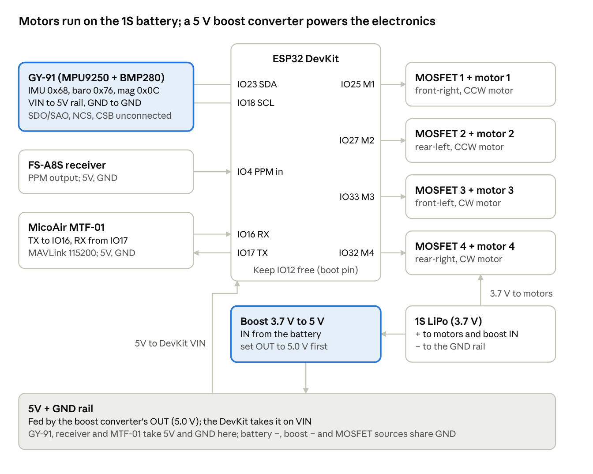
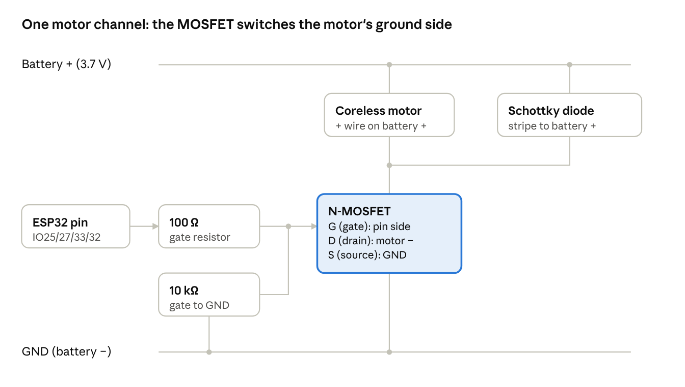

# ArduPilot on ESP32 DevKit — Coreless 1S Indoor MTF-01 Build Guide

Oct 15, 2026 · @lukas

## At a glance

This guide builds **the coreless drone that flies AltHold and PosHold**: a classic ESP32 DevKit with the same GY-91, MicoAir MTF-01 and FS-A8S as the WEMOS build, but four **3.7 V coreless (brushed) motors** driven by MOSFETs from a **1S battery**, with DJI Tello props. Everything that isn't about the motors and power is the same as the WEMOS guide: same pins, same sensors, same Fixes 1–4.

> **Status and safety.** ArduPilot on ESP32 is experimental. Keep props **off** until Part 8, fly tethered first, and never near people. A coreless motor at full power can cut skin.

**Tested version.** The same ArduPilot as your WEMOS: `git describe` = `ArduPilot-4.6.0-beta1-9022-g9dd2e0f350` (commit `9dd2e0f3`), ESP-IDF 5.3. The boot log calls it `ArduCopter V4.8.0-dev (9dd2e0f3)`.

**How to use this guide:** work through the Parts in order. Each step ends with a **Check**; don't move on until it passes. In command blocks, a blank line separates commands, a line ending in `\` continues on the next line, and text after `#` is a comment.

**What changes from the WEMOS build:**

|  | WEMOS (brushless) | This build (coreless) |
| --- | --- | --- |
| Board | WEMOS D1 Mini ESP32 | ESP32 DevKit (same chip, same pins) |
| Board folder | `esp32lukas6050` | `esp32lukascoreless` (its own folder, so the WEMOS is never touched) |
| Motors | A2212 1400KV + 40A ESCs | 4 × 3.7 V coreless motors, one MOSFET each |
| Battery | 3S LiPo (11.1 V) | **1S LiPo (3.7 V)** straight to the motors |
| 5 V for the electronics | One ESC's BEC | **Boost converter** 3.7 V → 5 V into the DevKit's VIN |
| `MOT_PWM_TYPE` | 0 (normal PWM) | **3 (Brushed)**, in `defaults.parm` |
| Motor signal | 1000–2000 µs pulses at 490 Hz | On/off switching at 16 kHz, 0–100% power (`RC_SPEED` becomes 16000 by itself) |
| ESC calibration | Needed (Part 7) | **None**: ArduPilot skips it for brushed motors |
| Props | 8045 | DJI Tello **3044P** (3.0 inch) |
| Initial Tune Parameters | For the big frame | Airscrew **3**, **1** cell, LiPo (Part 6) |

**How brushed mode works, in one picture.** Think of a light dimmer. An ESC is told a speed; a coreless motor isn't. The ESP32 switches each motor's power on and off 16,000 times a second, and the share of time it is on sets the speed. The MOSFET is the switch; the ESP32 pin is the finger flicking it. ArduPilot's ESP32 motor code has this mode built in, so the firmware needs no extra fix for it.

**The four source fixes** (Part 4) are the same as in the WEMOS guide: optical flow on (`esp32.h`), motors stuck at idle (`takeoff_check.cpp`), I2C IMU reader priority (`Scheduler.h`), and ESC calibration saving (`esc_calibration.cpp`). The last one doesn't affect this drone, because brushed motors skip ESC calibration, but it stays in the shared source.

**Part numbers in this guide.** The MOSFET, diode, resistor and boost converter part numbers are proven, common choices. If your circuit uses different parts that meet the same specs (1.2), keep yours.

## Part 1: Parts and wiring

This drone has **two power paths and one ground**. The 1S battery feeds the motors directly, each through its own MOSFET. A boost converter turns the same 3.7 V into 5 V for the DevKit and the sensors. The GY-91 still needs only four wires (VIN, GND, SDA, SCL).

### 1.1 Parts

| Part | Notes |
| --- | --- |
| ESP32 DevKit (ESP32-WROOM-32, 4 MB flash) | Classic ESP32 DevKit V1. Same chip and pins as the WEMOS MINI32 |
| GY-91 (MPU9250 + BMP280) | I2C. The compass needs a genuine MPU9250 whose AK8963 answers: Part 2 checks it |
| MicoAir MTF-01 | Optical flow + rangefinder, MAVLink on a UART |
| FlySky FS-A8S receiver + transmitter | PPM output |
| 4 × 3.7 V coreless motors: 2 CW + 2 CCW | Sold in pairs; the two types have different wire colours |
| 4 × DJI Tello 3044P props: 2 CW + 2 CCW | 3.0 inch, push-fit. Check they grip your motor shafts tightly |
| 4 × logic-level N-MOSFET, e.g. AO3400A or SI2302 | One per motor; must switch fully on from a 3.3 V gate |
| 4 × Schottky diode, e.g. SS14 or 1N5819 | One across each motor |
| 4 × 100 Ω and 4 × 10 kΩ resistors | Gate resistor and gate pull-down, one pair per motor |
| Boost converter 3.7 V → 5 V, 1 A or more (e.g. an MT3608 module) | Powers the DevKit, GY-91, receiver and MTF-01 |
| 1S LiPo, 3.7 V | High-discharge type: four motors draw a lot of current |
| 470 µF capacitor or larger, 10 V or more | Across the battery leads, next to the MOSFETs |
| Short jumper wires, open-cell foam, soft foam tape | Keep the GY-91 wires under about 10 cm |

**What "the same specs" means for your own parts.** MOSFET: N-channel, rated on-resistance at a gate voltage of 2.5 V or lower (that is what "logic-level" means at 3.3 V), a current rating well above the motor's stall current, and 12 V or more drain-source. Diode: Schottky, 1 A or more.

### 1.2 Pin table

The DevKit's silkscreen names some pins differently: D23 = IO23, RX2 = IO16, TX2 = IO17.

| Device pin | DevKit pin | Notes |
| --- | --- | --- |
| GY-91 VIN / GND | 5V rail / GND | VIN feeds the GY-91's own 3.3V regulator |
| GY-91 3V3 | not connected | The regulator's output: don't feed power into it |
| GY-91 SDA | **IO23** (D23) | I2C data (IMU, barometer and compass share it) |
| GY-91 SCL | **IO18** (D18) | I2C clock |
| GY-91 SDO/SAO, NCS, CSB | not connected | The module sets I2C mode and addresses 0x68 / 0x76 itself. If the Part 2 scan shows 0x69 or 0x77, tie SDO/SAO to GND |
| FS-A8S PPM | IO4 (D4) | Use the PPM output |
| FS-A8S + / − | 5V rail / GND |  |
| MTF-01 TX | IO16 (RX2) | DevKit RX, ArduPilot SERIAL3 |
| MTF-01 RX | IO17 (TX2) | DevKit TX |
| MTF-01 VCC / GND | 5V rail / GND |  |
| Motor 1–4 MOSFET gates, each through 100 Ω | IO25, IO27, IO33, IO32 | Plus 10 kΩ from each gate to GND |
| MOSFET sources (S) | GND | All four |
| MOSFET drains (D) | Each motor's − wire | One MOSFET per motor |
| Motor + wires | Battery + (3.7 V) | All four |
| Boost converter IN+ / IN− | Battery + / − |  |
| Boost converter OUT+ / OUT− | DevKit **VIN** / GND | This is the 5V rail |

**The I2C pins in your wiring, in `hwdef.dat` (4.1) and in the Part 2 sketch must be the same: SDA IO23, SCL IO18.** If they differ, ArduPilot never finds the IMU, startup never finishes, and Mission Planner gets no heartbeat even though the WiFi network shows up.

**Wiring schematic**



Arrows show which way a signal or power travels; SDA and SCL carry data both ways. Every device's GND must join the battery's −, or the signals have no reference.

**One motor channel** (build it four times)



The MOSFET switches the motor's ground side: the motor's + wire always sits on battery +, and the MOSFET connects its − wire to GND when the ESP32 pin is high. The 100 Ω resistor limits the pin current when the gate switches. The 10 kΩ pull-down holds the gate low while the ESP32 boots and its pins float, so no motor starts by itself. The diode catches the voltage spike the motor makes each time it switches off; without it, MOSFETs die.

### 1.3 Wiring rules

- **Never put I2C (or anything with a pull-up) on IO12.** IO12 is an ESP32 boot pin: pulled high at power-up, it sets the flash to 1.8V and the board won't boot. Also leave IO6–IO11 alone (internal flash).
- **Set the boost converter to 5.0 V with a multimeter before you connect its output.** Adjustable modules leave the factory at any voltage, and too much damages the 5 V devices.
- **Keep the motor current out of the DevKit.** Battery, MOSFETs and motors connect with short, thick wires among themselves. Take the boost converter's input straight from the battery leads.
- **One ground.** Battery −, boost converter IN− and OUT−, all four MOSFET sources and the DevKit's GND join together.
- **Never leave out a 10 kΩ pull-down.** Without it, a motor can twitch or run at power-up.
- **Diode stripe (cathode) to battery +.** The wrong way round, it shorts the battery whenever that MOSFET turns on.
- **Capacitor polarity:** its + leg (the long one) to battery +.
- **Bench work with USB:** USB powers the DevKit, the battery powers only the motors, and the boost converter's output stays unplugged. Don't feed VIN from the boost converter and USB at the same time.
- **Keep the GY-91 wires short** (under about 10 cm) and away from the motor and battery wires. On a small frame this matters even more: the compass is on the GY-91, and motor current close to it pulls the heading.
- **Cover the BMP280** (the small metal can with a pin-hole) with a piece of open-cell foam to keep prop wash off it. Don't seal it airtight.
- **Mount the GY-91 chip side up, its Y axis forward, X axis right** (`ROTATION_NONE`). Flat, near the centre of the frame, on firm foam. 6.5 confirms it.
- **Mount the MTF-01** underneath, lens straight down, square to the frame, with a clear view of the floor.

**Motor layout** (quad X, viewed from above, front at the top). ArduPilot's numbering is not clockwise:

| Pin | Motor | Position | Spin | Motor type | Motor Test button |
| --- | --- | --- | --- | --- | --- |
| IO25 | 1 | front-right | CCW | CCW motor | A |
| IO27 | 2 | rear-left | CCW | CCW motor | C |
| IO33 | 3 | front-left | CW | CW motor | D |
| IO32 | 4 | rear-right | CW | CW motor | B |

**A coreless motor's direction is set by its type and its wiring.** Put a CW motor where the table says CW, with its + wire on battery +. A motor spinning the wrong way is either the wrong type or wired backwards: swapping its two wires reverses it, but a motor run against its type is weaker, so swap it for the right type first.

**Check:** before powering up, with a multimeter: battery + and GND are not shorted, the boost output reads 5.0 V (before it is connected), each gate pin reads about 10 kΩ to GND, and nothing is wired to IO12.

## Part 2: Test the GY-91 and the motor channels before you build

Two Arduino sketches prove the hardware before ArduPilot is involved: 2.1 checks the GY-91, 2.2 spins each motor through its MOSFET one at a time. Arduino IDE, **ESP32 core 3.x**, board **ESP32 Dev Module**, Serial Monitor at 115200.

### 2.1 GY-91 check

Put the board on a folded towel, away from the laptop, and don't touch it while it measures. The sketch uses the same pins as the `ESP32_I2CBUS` line in 4.1: SDA IO23, SCL IO18.

```cpp
// GY-91 check for ArduPilot on ESP32: I2C scan, chip ID, compass, and a still-noise test.
// Wiring: SDA = IO23, SCL = IO18 (the same pins as ESP32_I2CBUS in hwdef.dat). Board on a towel, don't touch it.
#include <Wire.h>

const int SDA_PIN = 23, SCL_PIN = 18;
const uint8_t ADDR = 0x68;          // MPU9250, SDO/SAO low
const uint8_t MAG  = 0x0C;          // AK8963 inside the MPU9250
const int N = 500;                  // samples per test (about 2.5 s)
uint8_t who = 0;

void writeReg(uint8_t reg, uint8_t val) {
  Wire.beginTransmission(ADDR);
  Wire.write(reg);
  Wire.write(val);
  Wire.endTransmission();
}

bool readFrom(uint8_t addr, uint8_t reg, uint8_t *buf, uint8_t n) {
  Wire.beginTransmission(addr);
  Wire.write(reg);
  if (Wire.endTransmission(false) != 0) return false;     // repeated start
  if (Wire.requestFrom(addr, n) != n) return false;
  for (uint8_t i = 0; i < n; i++) buf[i] = Wire.read();
  return true;
}

void setup() {
  Serial.begin(115200);
  delay(1000);
  Wire.begin(SDA_PIN, SCL_PIN, 400000);                    // 400 kHz like ArduPilot

  Serial.println("\n=== I2C scan ===");
  for (uint8_t a = 1; a < 127; a++) {
    Wire.beginTransmission(a);
    if (Wire.endTransmission() == 0) Serial.printf("  device at 0x%02X\n", a);
  }

  readFrom(ADDR, 0x75, &who, 1);                           // WHO_AM_I
  Serial.printf("WHO_AM_I = 0x%02X : ", who);
  if (who == 0x71 || who == 0x73)  Serial.println("MPU9250/9255 - IMU and compass OK for this guide");
  else if (who == 0x70)            Serial.println("MPU6500 - IMU works, but there is NO compass inside");
  else                             Serial.println("NOT an ID ArduPilot's Invensense driver expects (clone?)");

  writeReg(0x6B, 0x80);                                    // PWR_MGMT_1: reset
  delay(100);
  writeReg(0x6B, 0x01);                                    // wake up, gyro clock
  writeReg(0x1A, 0x03);                                    // CONFIG: gyro low-pass about 44 Hz
  writeReg(0x1B, 0x00);                                    // GYRO_CONFIG: +-250 dps = 131 per dps
  writeReg(0x1C, 0x00);                                    // ACCEL_CONFIG: +-2 g = 16384 per g
  writeReg(0x1D, 0x03);                                    // ACCEL_CONFIG2: accel low-pass about 44 Hz

  writeReg(0x37, 0x02);                                    // INT_PIN_CFG: I2C bypass on, as ArduPilot does
  delay(10);
  uint8_t wia = 0;
  bool magOk = readFrom(MAG, 0x00, &wia, 1);               // AK8963 WIA register
  Serial.printf("Compass AK8963 at 0x0C: %s, WIA = 0x%02X (expect 0x48)\n",
                magOk ? "answers" : "NOT found", wia);
  delay(200);
}

void loop() {
  double s[6] = {0}, q[6] = {0};
  int good = 0;
  for (int i = 0; i < N; i++) {
    uint8_t b[14];
    if (readFrom(ADDR, 0x3B, b, 14)) {                     // accel x,y,z, temperature, gyro x,y,z
      int16_t r[7];
      for (int k = 0; k < 7; k++) r[k] = (int16_t)((b[2 * k] << 8) | b[2 * k + 1]);
      double v[6] = { r[0] / 16.384, r[1] / 16.384, r[2] / 16.384,     // accel in milli-g
                      r[4] / 131.0,  r[5] / 131.0,  r[6] / 131.0 };   // gyro in deg/s
      for (int k = 0; k < 6; k++) { s[k] += v[k]; q[k] += v[k] * v[k]; }
      good++;
    }
    delay(5);
  }
  if (good < N / 2) {
    Serial.printf("Only %d/%d reads worked: check the wiring\n", good, N);
    delay(3000);
    return;
  }
  double m[6], sd[6];
  for (int k = 0; k < 6; k++) {
    m[k] = s[k] / good;
    sd[k] = sqrt(fmax(0.0, q[k] / good - m[k] * m[k]));
  }
  double accN = fmax(sd[0], sd[1]);
  double gyrN = fmax(fmax(sd[3], sd[4]), sd[5]);
  Serial.printf("\nreads OK %d/%d\n", good, N);
  Serial.printf("ACC  mean x %7.1f y %7.1f z %7.1f mg    noise x %5.2f y %5.2f z %5.2f mg\n",
                m[0], m[1], m[2], sd[0], sd[1], sd[2]);
  Serial.printf("GYRO mean x %6.2f y %6.2f z %6.2f dps   noise x %5.3f y %5.3f z %5.3f dps\n",
                m[3], m[4], m[5], sd[3], sd[4], sd[5]);
  Serial.printf("ACC noise %s   GYRO noise %s\n",
                accN <= 5 ? "GOOD" : accN <= 10 ? "OK" : "BAD",
                gyrN <= 0.15 ? "GOOD" : gyrN <= 0.3 ? "OK" : "BAD");
  delay(2000);
}
```

**A good GY-91 prints:** `device at 0x68` and `device at 0x76` in the scan, `WHO_AM_I = 0x71` (0x73 for an MPU9255), `Compass AK8963 at 0x0C: answers, WIA = 0x48`, and `ACC noise GOOD   GYRO noise GOOD`. The compass doesn't show in the scan: it only appears after the sketch turns on the bypass, which is exactly what ArduPilot does.

**Run it twice:** on the towel (USB only), then fitted on the frame (USB only).

| Result | Meaning |
| --- | --- |
| `WHO_AM_I` is 0x70 | An MPU6500: no compass. Use a GY-91 with a genuine MPU9250 |
| `WHO_AM_I` not 0x70 / 0x71 / 0x73 | ArduPilot won't detect this chip. Use another module |
| Compass `NOT found` with `WHO_AM_I` 0x71/0x73 | This module's compass is dead or missing: use another module |
| Reads fail, or 0x68 / 0x76 missing from the scan | Wiring, pins that don't match the sketch, or the SDO/SAO pin (1.2) |
| BAD on the towel | **The chip itself is noisy**: replace the GY-91 |
| GOOD on the towel, BAD on the frame | The frame or mount shakes it: firmer foam, no wires tugging |
| GOOD in both | **The GY-91 is fine.** |

**Check:** `WHO_AM_I` 0x71 or 0x73, the compass answers with `WIA = 0x48`, and GOOD (or at least OK) in both runs. 2.2 adds the third run, with the motors spinning.

### 2.2 Motor channel check (props OFF)

This sketch switches each motor pin at 16 kHz, the same way ArduPilot will, and ramps one motor at a time to 30% and back. It proves each MOSFET, diode and motor works, that the right motor answers each pin, and that the others stay still.

**Wiring for this test:** props **off**, USB to the PC (it powers the DevKit), the 1S battery on the motor side, the boost converter's output **unplugged** (1.3).

```cpp
// MOTOR CHANNEL CHECK for 4 coreless motors through MOSFETs - no ArduPilot. PROPS OFF.
// Each pin is switched at 16 kHz (as ArduPilot's brushed mode does) and ramped to 30% and back.

const int MOTOR_PINS[4] = {25, 27, 33, 32};      // motor 1-4 pins from the board file
const char *NAMES[4] = {"Motor 1 (IO25) front-right, CCW", "Motor 2 (IO27) rear-left, CCW",
                        "Motor 3 (IO33) front-left, CW",   "Motor 4 (IO32) rear-right, CW"};
const int FREQ = 16000;                          // 16 kHz
const int BITS = 10;                             // duty 0-1023
const int MAX_DUTY = 1023 * 30 / 100;            // 30% power at most

void allOff() {
  for (int i = 0; i < 4; i++) ledcWrite(MOTOR_PINS[i], 0);
}

void waitEnter() {
  while (Serial.available()) Serial.read();       // clear old input
  while (!Serial.available()) delay(10);          // wait for Enter
  while (Serial.available()) Serial.read();
}

void setup() {
  Serial.begin(115200);
  delay(1000);
  for (int i = 0; i < 4; i++) ledcAttach(MOTOR_PINS[i], FREQ, BITS);
  allOff();

  Serial.println("\n=========== MOTOR CHANNEL CHECK ===========");
  Serial.println("Check: PROPS OFF, battery on the motor side, boost output unplugged.");
  Serial.println(">> Press Enter to start.");
  waitEnter();
}

void loop() {
  for (int m = 0; m < 4; m++) {
    Serial.printf("\n%s: ramping up - ONLY this motor should spin\n", NAMES[m]);
    for (int d = 0; d <= MAX_DUTY; d += 4) {      // about 2 s up
      ledcWrite(MOTOR_PINS[m], d);
      delay(25);
    }
    delay(1500);                                  // hold at 30%
    for (int d = MAX_DUTY; d >= 0; d -= 4) {      // about 2 s down
      ledcWrite(MOTOR_PINS[m], d);
      delay(25);
    }
    allOff();
    delay(1000);
  }
  Serial.println("\nAll four done, motors off. >> Press Enter to run again.");
  waitEnter();
}
```

| You see | Meaning |
| --- | --- |
| Each motor spins up alone, in order 1-2-3-4, at the position its name says | **Channels are fine** |
| Every motor turns the way the motor layout (1.3) says | Directions are fine |
| A motor twitches or runs as soon as the battery is plugged in | Missing 10 kΩ pull-down, or the MOSFET's D and S are swapped (its built-in diode then conducts all the time) |
| One motor never spins | That channel's gate wire, gate resistor, MOSFET or motor wire |
| A different motor spins than the name says | Pins or motor wires crossed: match the pin table (1.2) |
| A MOSFET or diode gets hot at 30% | MOSFET not fully on at 3.3 V (not logic-level), or the diode is missing or reversed |

**Third GY-91 run:** flash the 2.1 sketch again and run it with the battery plugged in and the motors stopped. GOOD until the battery goes in means electrical noise from the motor wiring: route those wires away from the GY-91 and check the 470 µF capacitor.

**Check:** all four motors pass in order and direction, nothing gets hot, and the GY-91 is still GOOD (or OK) with the battery plugged in. Flash ArduPilot over this sketch in Part 5.

## Part 3: Build environment (once)

**Already build the WEMOS in `~/ardupilot_esp32_build/ardupilot`?** Use the same folder and skip to Part 4: this drone gets its own board folder, so the WEMOS files are never touched.

Use **Ubuntu 22.04 or newer** (native, or WSL2 on Windows). Check with `lsb_release -a`. Run these in order.

**3.1 System packages**

```bash
sudo apt update

sudo apt install -y git wget flex bison gperf cmake ninja-build ccache \
  libffi-dev libssl-dev dfu-util libusb-1.0-0 python3 python3-pip python3-venv
```

**3.2 Clone ArduPilot**

```bash
mkdir -p ~/ardupilot_esp32_build && cd ~/ardupilot_esp32_build

git clone --recursive https://github.com/ArduPilot/ardupilot.git    # several GB

cd ardupilot

git checkout 9dd2e0f3                               # the commit your drones were built from

git submodule update --init --recursive

git submodule status | grep -E '^[-+U]'             # must print nothing

Tools/environment_install/install-prereqs-ubuntu.sh -y
```

Then **close the terminal and open a new one**, so the new PATH loads.

**3.3 Fetch ESP-IDF 5.3**

```bash
cd ~/ardupilot_esp32_build/ardupilot

./Tools/scripts/esp32_get_idf.sh

git -C modules/esp_idf describe --tags               # must show v5.3.x

git -C modules/esp_idf submodule status --recursive | grep -E '^[-+U]'   # must print nothing
```

**3.4 Create the ESP-IDF Python environment** (in a fresh terminal)

```bash
which python3                                        # must be /usr/bin/python3

echo "VIRTUAL_ENV=$VIRTUAL_ENV"                      # must be empty

cd ~/ardupilot_esp32_build/ardupilot

./modules/esp_idf/install.sh                         # ends with "All done!"
```

**3.5 The `get_idf` shortcut.** Add this one line to the end of `~/.bashrc`, then open a new terminal:

```bash
alias get_idf='source ~/ardupilot_esp32_build/ardupilot/modules/esp_idf/export.sh'
```

Then, once:

```bash
cd ~/ardupilot_esp32_build/ardupilot

get_idf                                              # load the tools

python3 -m pip install empy==3.3.4 pexpect           # once per environment
```

**Check:** `get_idf` ends with `Done!`, and `which python3` now points into `~/.espressif/python_env/`. Run `get_idf` in every new terminal before building. `git describe` in the ardupilot folder should print `ArduPilot-4.6.0-beta1-9022-g9dd2e0f350`.

## Part 4: Board files and the ESP32 fixes

ArduPilot builds a board from two files in its own folder: `hwdef.dat` (pins and sensors) and `defaults.parm` (parameters baked into the firmware, applied to every parameter you haven't saved yet). This drone gets its **own folder, `esp32lukascoreless`**, so building it never changes the WEMOS's `esp32lukas6050`. If your DevKit folder already has another name, use yours everywhere this guide says `esp32lukascoreless`. Every step is safe to run again.

### 4.1 Create the board folder and `hwdef.dat`

This is the WEMOS `hwdef.dat` line for line: the DevKit uses the same pins. The motor type is not in this file; it is in `defaults.parm`. Change only `WIFI_SSID` and `WIFI_PWD` (8+ characters) if you want this drone on its own network, which helps when both drones are switched on together.

```bash
cd ~/ardupilot_esp32_build/ardupilot

mkdir -p libraries/AP_HAL_ESP32/hwdef/esp32lukascoreless

cat > libraries/AP_HAL_ESP32/hwdef/esp32lukascoreless/hwdef.dat <<'EOF'
# esp32lukas6050: WEMOS D1 Mini ESP32 (or DevKit) + MPU6050 (GY-521) or GY-91 on I2C, indoor MTF-01 build
define HAL_ESP32_BOARD_NAME "esp32-lukas-6050"

# --- I2C bus 0 on the standard ESP32 I2C pins (NOT IO12: it is a boot strapping pin)
#             Port       SDA         SCL          SPEED    INTERNAL SOFT
ESP32_I2CBUS  I2C_NUM_0  GPIO_NUM_23 GPIO_NUM_18  400*KHZ  false    false

# --- IMU: MPU6050, or the GY-91's MPU9250, at I2C address 0x68 (AD0/SAO low)
define HAL_INS_DEFAULT HAL_INS_MPU60XX_I2C
IMU Invensense I2C:0:0x68 ROTATION_NONE
define INS_MAX_INSTANCES 3

# --- Barometer: the GY-91's BMP280 (or a BMP280 module) at 0x76; boots fine without one
BARO BMP280 I2C:0:0x76
define HAL_BARO_ALLOW_INIT_NO_BARO 1

# --- Compass: none used (the GY-91's AK8963 stays off); an external I2C compass on the same bus is found by probing
define AP_COMPASS_PROBING_ENABLED 1
COMPASS AK8963:probe_mpu9250 I2C:0:0x0C ROTATION_NONE
define AP_COMPASS_AK8963_ENABLED 1

# --- no airspeed sensor
define AP_AIRSPEED_ENABLED 0

# --- ADC pins (battery monitor, optional)
ESP32_ADC_PIN ADC1_GPIO35_CHANNEL 11   35
ESP32_ADC_PIN ADC1_GPIO34_CHANNEL 11   34
ESP32_ADC_PIN ADC1_GPIO39_CHANNEL 11   39
ESP32_ADC_PIN ADC1_GPIO36_CHANNEL 11   36

# --- WiFi access point (change SSID and password)
define HAL_ESP32_WIFI 1
define WIFI_SSID "lukas-drone"
define WIFI_PWD "changeme123"

# --- motor outputs 1-4
ESP32_RCOUT GPIO_NUM_25
ESP32_RCOUT GPIO_NUM_27
ESP32_RCOUT GPIO_NUM_33
ESP32_RCOUT GPIO_NUM_32

# --- RC input (PPM) on IO4
define HAL_ESP32_RCIN GPIO_NUM_4
define HAL_ESP32_RMT_RX_PIN_NUMBER 4

# --- UARTs: SERIAL0 = USB, UART1 on IO16 (RX) / IO17 (TX) = MTF-01 (SERIAL3)
ESP32_SERIAL  UART_NUM_0  GPIO_NUM_3    GPIO_NUM_1
ESP32_SERIAL  UART_NUM_1  GPIO_NUM_16   GPIO_NUM_17

# --- SD card / logging: same as the tested esp32lukas board (the MINI32 has no card; boot errors are harmless)
define AP_FILESYSTEM_ESP32_ENABLED 1
define HAL_ESP32_SDMMC 1
define HAL_ESP32_SDCARD 1
define LOGGER_MAVLINK_SUPPORT 1
define HAL_LOGGING_BACKENDS_DEFAULT 1

# --- optical flow (MTF-01): needs the esp32.h fix (4.3)
define AP_OPTICALFLOW_ENABLED 1
EOF
```

### 4.2 Create `defaults.parm`

The WEMOS `defaults.parm` with **one value changed: `MOT_PWM_TYPE 3`** (Brushed), plus the two comments that describe it. `MOT_PWM_MIN 1000` and `MOT_PWM_MAX 2000` stay: in brushed mode they mean 0% and 100% motor power.

```bash
cd ~/ardupilot_esp32_build/ardupilot

cat > libraries/AP_HAL_ESP32/hwdef/esp32lukascoreless/defaults.parm <<'EOF'
# esp32lukascoreless defaults (DevKit + GY-91 + MTF-01, 1S coreless motors, indoor). Applied to every never-saved parameter.

# --- loop rate: the ESP32 cannot run 400 Hz
SCHED_LOOP_RATE 150

# --- frame: quad X, brushed coreless motors on MOSFETs (MIN/MAX = 0% and 100% power)
FRAME_CLASS 1
FRAME_TYPE 1
MOT_PWM_TYPE 3
MOT_PWM_MIN 1000
MOT_PWM_MAX 2000

# --- flight modes on channel 5: Stabilize / AltHold / AltHold (Loiter stays OFF until Part 8)
FLTMODE_CH 5
FLTMODE1 0
FLTMODE2 0
FLTMODE3 0
FLTMODE4 2
FLTMODE5 2
FLTMODE6 2

# --- channel 6 = arm (up) / disarm (down); after boot flip it down, then up
RC6_OPTION 153

# --- never start ESC calibration from ArduPilot: it hangs the ESP32 (calibrate with the sketch)
ESC_CALIBRATION 9

# --- logging off: no SD card on the MINI32 (set 1 once you fit one)
LOG_BACKEND_TYPE 0

# --- failsafes
FS_THR_ENABLE 3
FS_THR_VALUE 975
FS_GCS_ENABLE 0
FS_EKF_ACTION 1

# --- no compass on either option (set COMPASS_ENABLE 1 and EK3_SRC1_YAW 1 if you add one)
COMPASS_ENABLE 0

# --- MTF-01 on SERIAL3 (IO16 RX / IO17 TX)
SERIAL3_PROTOCOL 1
SERIAL3_BAUD 115
FLOW_TYPE 5
RNGFND1_TYPE 10
RNGFND1_MIN 0.01
RNGFND1_MAX 8
RNGFND1_ORIENT 25

# --- EKF3 sources for INDOOR flight: flow velocity, rangefinder height, no yaw source
EK3_SRC_OPTIONS 0
EK3_SRC1_POSXY 0
EK3_SRC1_VELXY 5
EK3_SRC1_POSZ 2
EK3_SRC1_VELZ 0
EK3_SRC1_YAW 1
EOF
```

**What this file does not need:**

- **`RC_SPEED`:** when `MOT_PWM_TYPE` is 3, ArduPilot changes the default `RC_SPEED` from 490 to 16000 Hz by itself (`ArduCopter/system.cpp`). You check it in 6.2.
- **ESC calibration:** ArduPilot skips it for brushed motors (`ArduCopter/esc_calibration.cpp` returns at once). `ESC_CALIBRATION 9` stays from the WEMOS file and does nothing here.
- **The tune values for Tello props:** Mission Planner's Initial Tune Parameters writes those in 6.3.

The other old comments (compass, EKF yaw, SD card) are the same as in the WEMOS file: the values are what flies, only the comments are out of date. The compass is switched on in 6.2.

### 4.3 Fix 1: turn optical flow back on

ArduPilot's `libraries/AP_HAL/board/esp32.h` forces `AP_OPTICALFLOW_ENABLED 0` for every ESP32 board, after your board file is read. This wraps it so your board's `define AP_OPTICALFLOW_ENABLED 1` wins.

```bash
cd ~/ardupilot_esp32_build/ardupilot

F=libraries/AP_HAL/board/esp32.h

grep -q "#ifndef AP_OPTICALFLOW_ENABLED" $F || \
  sed -i 's/^#define AP_OPTICALFLOW_ENABLED 0$/#ifndef AP_OPTICALFLOW_ENABLED\n#define AP_OPTICALFLOW_ENABLED 0\n#endif/' $F

grep -n -B1 -A1 "AP_OPTICALFLOW_ENABLED" $F
```

**Check:** three lines in a row: `#ifndef AP_OPTICALFLOW_ENABLED`, `#define AP_OPTICALFLOW_ENABLED 0`, `#endif`.

### 4.4 Fix 2: motors stuck at idle

The pre-takeoff check that releases the motors after arming (`ArduCopter/takeoff_check.cpp`) is wrapped in `#if HAL_WITH_ESC_TELEM`, which is 0 on every ESP32 board, so it compiles to an empty function and the motors stay at `MOT_SPIN_MIN`. This keeps only the ESC-telemetry parts conditional. It matters for brushed motors exactly as for ESCs.

```bash
cd ~/ardupilot_esp32_build/ardupilot

python3 - <<'EOF'
p = "ArduCopter/takeoff_check.cpp"
s = open(p).read()
if "no ESC telemetry: nothing to check" in s:
    print("already fixed - nothing to do")
else:
    a = "#if HAL_WITH_ESC_TELEM && FRAME_CONFIG != HELI_FRAME"
    b = "        takeoff_check_state.warning_ms = now_ms;\n"
    c = "    const bool motor_check_passed = motors_takeoff_check(g2.takeoff_rpm_min, g2.takeoff_rpm_max);\n"
    assert s.count(a) == 1 and s.count(b) == 1 and s.count(c) == 1, "file differs from expected - stop and check"
    s = s.replace(a, "#if FRAME_CONFIG != HELI_FRAME")
    s = s.replace(b, "#if HAL_WITH_ESC_TELEM\n" + b + "#endif\n")
    s = s.replace(c, "#if HAL_WITH_ESC_TELEM\n" + c + "#else\n    // no ESC telemetry: nothing to check\n    const bool motor_check_passed = true;\n#endif\n")
    open(p, "w").write(s)
    print("fixed")
EOF

grep -n "#if\|#else\|no ESC telemetry" ArduCopter/takeoff_check.cpp
```

**Check:** it prints `fixed` (or `already fixed - nothing to do`), and the grep shows `#if FRAME_CONFIG != HELI_FRAME`, two `#if HAL_WITH_ESC_TELEM`, one `#else` and `// no ESC telemetry: nothing to check`.

### 4.5 Fix 3: let the I2C IMU reader run on time

In `libraries/AP_HAL_ESP32/Scheduler.h` the SPI bus task gets priority 24, the same as the main flight loop, but the I2C bus task gets **5**, below the UART, timer, WiFi and motor tasks. With the IMU on I2C, its reader keeps getting pushed back: slow parameter loading and a laggy HUD. This sets it to 24.

```bash
cd ~/ardupilot_esp32_build/ardupilot

sed -i 's/I2C_PRIORITY = 5;/I2C_PRIORITY = 24;/' libraries/AP_HAL_ESP32/Scheduler.h

grep -n "I2C_PRIORITY = 24" libraries/AP_HAL_ESP32/Scheduler.h
```

**Check:** the grep prints exactly one line (line 78).

### 4.6 Fix 4: ESC calibration saving (shared source)

This fix is for the WEMOS's ESCs: it makes Mission Planner's **Calibrate ESCs** save its cleared flag on ESP32. The coreless drone never runs ESC calibration, but the fix lives in the shared source, so keep it in place for both drones. Already in your folder from the WEMOS build? The script says so and changes nothing.

```bash
cd ~/ardupilot_esp32_build/ardupilot

python3 - <<'EOF'
p = "ArduCopter/esc_calibration.cpp"
s = open(p).read()
if "ESP32 FIX: parameter saving" in s:
    print("already fixed - nothing to do")
else:
    a = "    // clear esc flag for next time\n    g.esc_calibrate.set_and_save(ESCCAL_NONE);\n\n    if (motors->is_normal_pwm_type()) {\n"
    assert s.count(a) == 1, "file differs from expected - stop and check"
    b = ("    // clear esc flag for next time\n"
         "    g.esc_calibrate.set_and_save(ESCCAL_NONE);\n"
         "#if CONFIG_HAL_BOARD == HAL_BOARD_ESP32\n"
         "    // ESP32 FIX: parameter saving and flash writing only run after setup()\n"
         "    // ends, and calibration never returns, so store the cleared flag now\n"
         "    g.esc_calibrate.save_sync(true, false);\n"
         "    for (uint32_t i = 0; i < HAL_STORAGE_SIZE / 8 + 1; i++) {\n"
         "        hal.storage->_timer_tick();\n"
         "    }\n"
         "#endif\n"
         "\n    if (motors->is_normal_pwm_type()) {\n")
    open(p, "w").write(s.replace(a, b))
    print("fixed")
EOF

grep -n "ESP32 FIX" ArduCopter/esc_calibration.cpp
```

**Check:** it prints `fixed` (or `already fixed - nothing to do`), and the grep shows one line.

### 4.7 Check the parameter names

A misspelled name in `defaults.parm` is silently ignored, so check them against ArduCopter's parameter list:

```bash
cd ~/ardupilot_esp32_build/ardupilot/Tools/autotest/param_metadata

python3 param_parse.py --vehicle ArduCopter --format json > /dev/null   # creates apm.pdef.json

cd ~/ardupilot_esp32_build/ardupilot

python3 - <<'EOF'
import json
d = json.load(open('Tools/autotest/param_metadata/apm.pdef.json'))
names = {k for grp in d.values() for k in grp}
bad = [l.split()[0] for l in open('libraries/AP_HAL_ESP32/hwdef/esp32lukascoreless/defaults.parm')
       if l.split('#')[0].strip() and l.split()[0] not in names]
print("Unknown parameters:", bad if bad else "none")
EOF
```

**Check:** it prints `Unknown parameters: none`.

## Part 5: Back up, build, check and flash

### 5.1 Back up a drone that already flies

If this DevKit already flies, copy its whole flash to your PC first: firmware, calibrations and every saved parameter. `read_flash` only copies; it doesn't change the board. Close Mission Planner first.

```bash
esptool.py --chip esp32 -p /dev/ttyUSB0 read_flash 0 0x400000 devkit_coreless_backup.bin
```

To put the board back exactly as it was, at any time:

```bash
esptool.py --chip esp32 -p /dev/ttyUSB0 write_flash 0x0 devkit_coreless_backup.bin
```

### 5.2 Build

```bash
cd ~/ardupilot_esp32_build/ardupilot

get_idf                                       # load the ESP32 tools

./waf configure --board=esp32lukascoreless    # choose this board

./waf copter                                  # build ArduCopter (about 10 minutes the first time)
```

**Check:** it ends with `'copter' finished successfully` and an `ardupilot.bin binary size` line showing about 34% free. If `waf` stops at `esp-idf_showinc` with `constraints ... doesn't exist`, run `export IDF_PYTHON_CHECK_CONSTRAINTS=no`, delete `build/esp32lukascoreless/esp-idf_build`, and build again.

To build the WEMOS again later, just pick its board: `./waf configure --board=esp32lukas6050`, then `./waf copter`. Each board builds into its own `build/` folder.

### 5.3 Confirm the sensors, the motor type and all fixes are inside

Do this before every flash that follows a board-file or source change.

```bash
cd ~/ardupilot_esp32_build/ardupilot

grep -o "\.sda=GPIO_NUM_[0-9]*, \.scl=GPIO_NUM_[0-9]*" build/esp32lukascoreless/hwdef.h   # I2C pins

grep "HAL_INS_PROBE1" build/esp32lukascoreless/hwdef.h                                    # IMU on I2C bus 0, 0x68

grep -o "AK8963::probe_mpu9250([^;]*" build/esp32lukascoreless/hwdef.h                     # compass

grep "^MOT_PWM_TYPE" libraries/AP_HAL_ESP32/hwdef/esp32lukascoreless/defaults.parm         # motor type

nm -C build/esp32lukascoreless/esp-idf_build/ardupilot.elf | grep -c AP_OpticalFlow_MAV   # Fix 1

nm -C -S build/esp32lukascoreless/esp-idf_build/ardupilot.elf | grep " Copter::takeoff_check()"   # Fix 2

grep -c "I2C_PRIORITY = 24" libraries/AP_HAL_ESP32/Scheduler.h                           # Fix 3

grep -c "ESP32 FIX" ArduCopter/esc_calibration.cpp                                        # Fix 4

grep -c "defaults.parm" build/esp32lukascoreless/ap_romfs_embedded.h                      # defaults embedded
```

**Check:**

| Line | Must show |
| --- | --- |
| I2C pins | `.sda=GPIO_NUM_23, .scl=GPIO_NUM_18` |
| `HAL_INS_PROBE1` | `AP_InertialSensor_Invensense::probe(*this,GET_I2C_DEVICE(0,0x68),ROTATION_NONE)` |
| Compass | `AK8963::probe_mpu9250(GET_I2C_DEVICE(0,0x0c),ROTATION_NONE)` |
| Motor type | `MOT_PWM_TYPE 3` |
| `AP_OpticalFlow_MAV` | A number above 0 (the test build: 8). A 0 means 4.3 didn't run |
| `Copter::takeoff_check()` | Size `000000a4`. `00000005` means 4.4 didn't run |
| `I2C_PRIORITY = 24` | 1. A 0 means 4.5 didn't run |
| `ESP32 FIX` | 1. A 0 means 4.6 didn't run |
| `defaults.parm` | 1 |

If you change a source file or a board file, run `./waf copter` again before flashing. After a board-file change, run `./waf configure --board=esp32lukascoreless` first.

### 5.4 Flash

Flash with **only USB connected**: battery unplugged, props off. Close Mission Planner and any serial monitor first: only one program can hold the port.

**Erase or not:**

| Situation | Do |
| --- | --- |
| New board, or one that had other firmware (including the Part 2 sketches) | Run `erase_flash` first, so `defaults.parm` applies to every parameter |
| **Your flying drone, updating the firmware** | **Skip `erase_flash`.** Your saved parameters and calibrations stay exactly as they are |

**On Windows with WSL2**, first pass the USB port to Ubuntu. In an **Admin PowerShell**:

```powershell
winget install --interactive --exact dorssel.usbipd-win   # once; then reopen PowerShell

usbipd list                                               # find the DevKit (CP2102 = 10c4:ea60, CH340 = 1a86:7523); note its BUSID, e.g. 1-1

usbipd bind --busid 1-1                                   # once per board

usbipd attach --wsl --busid 1-1                           # every time you plug it in; keep Ubuntu open
```

Then in **Ubuntu**:

```bash
ls /dev/ttyUSB* /dev/ttyACM* 2>/dev/null                  # find the port, e.g. /dev/ttyUSB0

sudo usermod -aG dialout $USER                            # once; then log out and back in

cd ~/ardupilot_esp32_build/ardupilot

get_idf

esptool.py --chip esp32 -p /dev/ttyUSB0 erase_flash       # new board only (see the table above)

ESPPORT=/dev/ttyUSB0 ESPBAUD=921600 ./waf copter --upload
```

**Check:** it ends with `Hash of data verified` and `Hard resetting`. To get the Windows COM port back for Mission Planner: `usbipd detach --busid 1-1`.

**If flashing won't start** (`Failed to connect`): hold the DevKit's **BOOT** button, press and release **EN**, release **BOOT**, then:

```bash
cd ~/ardupilot_esp32_build/ardupilot/build/esp32lukascoreless/esp-idf_build

esptool.py --chip esp32 -p /dev/ttyUSB0 --before no_reset -b 460800 write_flash @flash_args
```

Press **EN** once afterwards to start the firmware.

### 5.5 Check that it boots

Open a serial monitor at 115200 (Arduino IDE, or `python3 -m serial.tools.miniterm /dev/ttyUSB0 115200` in Ubuntu, quit with Ctrl+\]) and press **EN**.

| In the log | Meaning |
| --- | --- |
| `rst:0x1 (POWERON_RESET)` at the top | Normal |
| `Init ArduCopter V4.8.0-dev (9dd2e0f3)` | ArduPilot started |
| `Firmware change: erasing EEPROM...` | Normal on the first boot after `erase_flash` only |
| `sdmmc_...` errors, `sdcard is not mounted` | Harmless: the DevKit has no SD card |
| `loop_rate: actual: ...Hz, expected: 150Hz` every 10 s | **Startup finished**, the main loop runs |
| `Config Error: INS: unable to initialise driver` every 5 s | IMU not found: wiring or I2C pins (1.2) |
| A reset that repeats (`rst:0xc`, `0x7`, `0x8`, `0xf`) | Crash, watchdog or brownout: see Troubleshooting |

**The first boot after `erase_flash` is the slowest** (about a minute): ArduPilot saves every parameter for the first time, and on ESP32 that waits until startup has finished. Don't press EN or reopen the port during that minute, because a reset starts it over.

**Check:** the `loop_rate` line appears and the log stops resetting.

## Part 6: Mission Planner setup and calibration

Props **off** for this whole Part. Reboot the board (press EN) after any group of parameter changes. On a drone that already flies and was flashed without `erase_flash`, these settings are already in place: just check them.

### 6.1 Connect

- **USB (best for setup):** pick the DevKit's COM port and **115200** (not AUTO). In **Config → Planner**, **untick Reset on USB connect (DTR)**: with it ticked, every connect restarts the ESP32 and it has to boot all over again.
- **WiFi (good for watching values during tests):** join the drone's network (`lukas-drone`, or the SSID you set in 4.1), then connect with **TCP**, host **192.168.4.1**, port **5760**.

**Check:** the HUD shows **DISARMED**, and the parameter download finishes in well under a minute.

### 6.2 Set the parameters that need a reboot, and confirm brushed mode

In **Config → Full Parameter List**, set these and **Write Params**, then reboot:

| Parameter | Value | Why |
| --- | --- | --- |
| `COMPASS_ENABLE` | 1 | Turns on the GY-91's AK8963 compass. `EK3_SRC1_YAW` is already 1 (heading from the compass) |
| `MAV4_OPTIONS` | 2 | Don't forward MAVLink to or from the MTF-01. **First check `MAV4_DEVID` = 66310**, ArduPilot's ID for SERIAL3: the serial ports are the same as on the WEMOS, so the number is too. SERIAL0 (USB) = MAV1, SERIAL1 (WiFi) = MAV2, SERIAL2 = MAV3 (no pins, but MAVLink by default), SERIAL3 (MTF-01) = MAV4. Leave `MAV3_OPTIONS` at 0 |
| `SERIAL3_OPTIONS` | 0 | Leave at 0: the old bit 1024 for "don't forward" blocks arming on 4.7+ firmware; `MAV4_OPTIONS` does that job now |
| `FLOW_ORIENT_YAW` | 0 | Starting value; 6.9 tells you whether to change it |

After the reboot, **confirm the brushed setup** (nothing to set if it reads right):

| Parameter | Must read | If not |
| --- | --- | --- |
| `MOT_PWM_TYPE` | **3** (Brushed) | The flash wasn't erased on a new board (5.4), or this isn't the `esp32lukascoreless` firmware |
| `RC_SPEED` | **16000** | It was saved earlier with the old value. Set it to 16000 (Mission Planner warns that it is outside 50–490: accept it) and reboot |
| `MOT_PWM_MIN` / `MOT_PWM_MAX` | 1000 / 2000 | Set them back: they are 0% and 100% motor power |
| `SCHED_LOOP_RATE` | 150 |  |
| `FLOW_TYPE` | 5 | Fix 1 is missing (4.3) |

### 6.3 Initial Tune Parameters (Tello 3044P props, 1S)

The small frame and props need very different filter and acceleration values from the big WEMOS frame. Mission Planner calculates them.

**Setup → Mandatory Hardware → Initial Tune Parameters**, then type exactly:

| Field | Value |
| --- | --- |
| Airscrew size in inch | **3** |
| Battery cellcount | **1** |
| Battery type | **LiPo** |
| Battery cell fully charged voltage | **4.2** (filled in for you) |
| Battery cell fully discharged voltage | **3.3** (filled in for you) |
| T-motor checkbox | **unticked** |
| Add suggested settings checkbox | **unticked** |

Click **Calculate**. Mission Planner shows each parameter's old and new value: check them against the table below, then click **Write to FC** and reboot.

**Why 3:** DJI's part number 3044P means 3.0 inch diameter and 4.4 inch pitch; the calculator only wants the diameter.

**Why both tick boxes stay off:**

- **T-motor** sets `MOT_PWM_MIN 1100` and `MOT_PWM_MAX 1940`. In brushed mode those are 0% and 100% power, so you would lose the bottom and top of the throttle.
- **Add suggested settings** turns on a geofence (`FENCE_ENABLE 1`), which needs a GPS position this indoor flow drone doesn't have, so arming would be blocked. It also adds battery failsafes this build can't use yet.

**What it writes for 3 inch, 1 cell, LiPo** (from Mission Planner's own formulas):

| Parameter | Value |
| --- | --- |
| `INS_GYRO_FILTER` | 115 |
| `ATC_RAT_RLL_FLTD`, `ATC_RAT_RLL_FLTT`, `ATC_RAT_PIT_FLTD`, `ATC_RAT_PIT_FLTT`, `ATC_RAT_YAW_FLTT` | 57.5 |
| `ATC_RAT_RLL_FLTE`, `ATC_RAT_PIT_FLTE`, `ATC_RAT_YAW_FLTD` | 0 |
| `ATC_RAT_YAW_FLTE` | 2 |
| `ATC_ACC_R_MAX`, `ATC_ACC_P_MAX` | 1935 |
| `ATC_ACC_Y_MAX` | 333 |
| `MOT_THST_EXPO` | 0.41 |
| `MOT_THST_HOVER` | 0.2 (a start value: it learns the real hover throttle in the first hovers) |
| `ATC_THR_MIX_MAN` | 0.1 |
| `INS_ACCEL_FILTER` | 10 |
| `MOT_BAT_VOLT_MAX` / `MOT_BAT_VOLT_MIN` | 4.2 / 3.3 |
| `BATT_LOW_VOLT` / `BATT_CRT_VOLT` / `BATT_ARM_VOLT` | 3.6 / 3.5 / 3.6 |

**The battery values do nothing on this build:** `BATT_MONITOR` is 0, so ArduPilot never measures the battery. They are harmless.

**The pop-up after writing uses old names.** It says to set `PSC_ACCZ_P` to `MOT_THST_HOVER` and `PSC_ACCZ_I` to twice that after a test flight. On this firmware (4.8-dev) those are `PSC_D_ACC_P` and `PSC_D_ACC_I`, scaled by 0.1. Your drone flies on the calculator's values alone, so this step is optional. If you do it: `PSC_D_ACC_P` = 0.1 × `MOT_THST_HOVER` and `PSC_D_ACC_I` = 0.2 × `MOT_THST_HOVER`. Typing the pop-up's numbers into the new names makes them 10× too strong.

**Check:** after the reboot, `INS_GYRO_FILTER` reads 115, `MOT_THST_EXPO` 0.41, and `MOT_PWM_MIN` / `MOT_PWM_MAX` are still 1000 / 2000.

### 6.4 Were all three sensors found?

In **Config → Full Parameter List**, after the reboot:

| Parameter | Good |
| --- | --- |
| `INS_ACC_ID`, `INS_GYR_ID` | Any non-zero number: the IMU was found |
| `BARO1_DEVID` | **226817** = hex `0x037601`: BMP280 (type `03`), address `0x76`, I2C bus 0. 0 means no barometer |
| `COMPASS_DEV_ID` | **265217** = hex `0x040C01`: AK8963 (type `04`), address `0x0C`, I2C bus 0. 0 means no compass: check `COMPASS_ENABLE` = 1 and the Part 2 compass result |

The Messages tab after boot should also show `Barometer 1 calibration complete`.

### 6.5 Accelerometer and level

Always **power up with the drone sitting still**: ArduPilot measures the gyro's zero point in the first seconds.

In **Setup → Mandatory Hardware → Accel Calibration**: **Calibrate Accel** (six positions), then **Calibrate Level** with the frame on a level surface. **Check:** the HUD is level when the frame is level, and there is no `DCM Roll/Pitch inconsistent` message.

### 6.6 Orientation and IMU still check

**Orientation.** With the frame level, tilt the nose down: the HUD should pitch nose down. Lift the left side: the HUD should roll right. If either is wrong or swapped, the GY-91 is turned on the frame. Set `AHRS_ORIENTATION` by where its Y axis points: right = 2, backward = 4, left = 6. Reboot, check again, then redo 6.5. The compass turns with it.

**IMU still check** (Data → Status, frame on a level table, USB only, 5 minutes):

| Value | Good |
| --- | --- |
| HUD roll / pitch | Steady within about ±1° |
| `ax`, `ay` | Near 0, within about ±10 milli-g |
| `az` | Near −1000 (1 g) |
| `gx`, `gy`, `gz` | Near 0, small noise, no steady swing |

### 6.7 Compass calibration and heading check

1. **Setup → Mandatory Hardware → Compass.** The list should show the AK8963 (the `COMPASS_DEV_ID` from 6.4) with **Use Compass 1** ticked.
2. Take the drone **away from steel, metal-framed desks and the laptop** (outdoors is best), click **Start** under Onboard Mag Calibration, and rotate the drone slowly through every axis until the bar completes. Over WiFi is easiest, so no cable gets in the way.
3. When it reports success, **reboot**.
4. **Heading check:** compare the HUD heading with a phone compass, nose pointing N, E, S and W. **Check:** within about 15° at each.

If calibration keeps failing or the heading is off by 90° or 180°, recheck the orientation (6.6) first. Motor interference is measured with props on in Part 8.

### 6.8 Barometer check

| Value (Data → Status) | Good |
| --- | --- |
| `press_abs` | About 1000–1015 hPa near sea level, changing only slightly at rest |
| `press_temp` | Room temperature, a few degrees warmer is normal |
| Lift test: floor → above your head (about 1.5 m) → floor | `press_abs` drops by about 0.2 hPa and comes back |

The HUD altitude follows the MTF-01's rangefinder (`EK3_SRC1_POSZ 2`), not the barometer. This board won't warn you about a missing barometer at arming (`HAL_BARO_ALLOW_INIT_NO_BARO`), so this check is the only one you get.

### 6.9 MTF-01 checks

Configure the MTF-01 in **MicoAssistant** before connecting it: output protocol `mav_apm`, `mav_id` 200 (anything except 1), baud 115200.

**Data check** (hold the drone 30–50 cm over a textured floor, in normal room light):

| Value | Good |
| --- | --- |
| `rangefinder1` | Follows the height (about 30 at 30 cm, 50 at 50 cm) |
| `opt_qua` | Well above 0 (0 = can't track: plain floor, dim light, or the lens covered) |
| Messages | No `PreArm: Rangefinder 1: No Data` |

**Orientation (tilt) test.** `opt_m_x` and `opt_m_y` are the flow rate minus the drone's own rotation, so tilting over a still floor should cancel out:

1. Hold the drone level about 40 cm over the textured floor.
2. Without moving it sideways, rock it **left and right** about ±20° once a second: watch `opt_m_x`.
3. Rock it **nose down and nose up**: watch `opt_m_y`.

| While rocking | Meaning | Do |
| --- | --- | --- |
| Both stay small (under about 0.3) | Correct | Keep `FLOW_ORIENT_YAW 0` |
| Both swing large (about 1–3) | Reversed 180° | `FLOW_ORIENT_YAW = 18000`, reboot, repeat |
| Rolling moves `opt_m_y` instead | Rotated 90° | Try `9000`, then `-9000`; keep the one that passes |
| Only one axis swings large | Mirrored | Check the mounting and the MicoAssistant protocol |

An inverted flow orientation makes ArduPilot push the drone harder in the direction it drifts, which flips it in Loiter. Don't fly Loiter or PosHold until this passes.

**Move test:** right-click the map → **Set EKF Origin Here**. Carry the drone level at about 50 cm, 1 m forward, then 1 m right. The map icon should follow and stay put when you stop.

### 6.10 Radio, flight modes and arm switch

| Step | How | Check |
| --- | --- | --- |
| Radio | **Setup → Mandatory Hardware → Radio Calibration**: move every stick to its corners and every switch through every position, then **Click when Done** | Throttle moves bar 3 (about 1000 to 2000); roll, pitch, yaw on bars 1, 2, 4 |
| Flight modes | **Setup → Flight Modes**: flip the CH5 switch | The highlighted mode changes (Stabilize / AltHold) |
| Arm switch | **Data → Status → `ch6in`** while you flip CH6 | Goes **below 1200** and **above 1800**; if not, set the radio's CH6 end points to 100% |

## Part 7: Motor test (no ESC calibration)

Brushed motors have no ESC to teach, so there is **nothing to calibrate**: with `MOT_PWM_TYPE 3`, ArduPilot skips ESC calibration at startup (`ArduCopter/esc_calibration.cpp` returns straight away). Don't press **Calibrate ESCs** on this drone. The motor range is fixed by the parameters: `MOT_PWM_MIN 1000` = 0% power, `MOT_PWM_MAX 2000` = 100%, switched at `RC_SPEED` 16000 Hz.

### 7.1 Get ready (props OFF)

1. All **props off**.
2. Battery plugged in on the motor side. Either the boost converter powers the DevKit (Mission Planner over WiFi), or USB powers it with the boost output unplugged (1.3).
3. Mission Planner connected; 6.2 confirmed `MOT_PWM_TYPE` 3 and `RC_SPEED` 16000.

### 7.2 Motor Test

**Setup → Optional Hardware → Motor Test.** Throttle **10%**, duration **2 s**, then each button in turn:

| Button | Must spin | Direction |
| --- | --- | --- |
| A | Motor 1, front-right (IO25) | CCW |
| B | Motor 4, rear-right (IO32) | CW |
| C | Motor 2, rear-left (IO27) | CCW |
| D | Motor 3, front-left (IO33) | CW |

Then **Test all motors** at 10%, and again at 30%.

**Check:** each button spins the motor in the table, the way the table says. With all motors, they start together at 10% and are clearly faster at 30%. Nothing gets hot.

| You see | Meaning | Do |
| --- | --- | --- |
| The wrong motor spins | Pins or motor wires crossed | Match the pin table (1.2); re-run 2.2 |
| Wrong direction | Wrong motor type in that position, or its wires reversed | 1.3 motor layout: swap in the right type, or swap its two wires |
| One motor starts later than the others at 10% | That motor or its MOSFET is weaker | Try 15%; if it still lags, check it with the 2.2 sketch and replace the motor or MOSFET |
| A motor runs before you press anything | MOSFET D and S swapped, a dead MOSFET, or a missing pull-down | Unplug the battery; check that channel (1.2, 2.2) |

Your drone flies with ArduPilot's default spin values (`MOT_SPIN_ARM` 0.10, `MOT_SPIN_MIN` 0.15): leave them unless a motor won't start at those.

**Reading the outputs.** Mission Planner still shows `ch1out` to `ch4out` in microseconds, the same numbers as on the WEMOS: ArduPilot turns them into power on its way out. 1000 = off, 1100 = 10%, 1500 = 50%, 2000 = 100%.

## Part 8: Bench test, then indoor flight in stages

### 8.1 Bench test (props OFF)

Work through every item; fix any failure before moving on.

- Boot log shows the `loop_rate` line and stops resetting (5.5)
- `MOT_PWM_TYPE` 3, `RC_SPEED` 16000, and the Initial Tune values in place (6.2, 6.3)
- All three sensors found: `INS_ACC_ID`, `BARO1_DEVID`, `COMPASS_DEV_ID` non-zero (6.4)
- HUD level and steady within about ±1°; orientation check passes (6.6)
- Compass calibrated, HUD heading within about 15° of a phone at N, E, S, W (6.7)
- Radio bars correct; CH5 switches Stabilize / AltHold (6.10)
- Transmitter off → Mission Planner reports a radio failsafe
- MTF-01 data, tilt test and move test pass (6.9)
- **Motor Test** passes: A = front-right, B = rear-right, C = rear-left, D = front-left, each spinning the way the motor layout (1.3) says (7.2)
- **On battery power only** (boost converter feeding VIN, USB unplugged, Mission Planner over WiFi): the DevKit stays up while you run Motor Test at 50% on all motors. A reset here is a brownout: fix it before flying (Troubleshooting)
- **Arm:** after boot, flip CH6 **down, then up**. HUD shows **ARMED**, and **Data → Status** shows `ch1out` to `ch4out` at about **1100** with the stick down (10% power, `MOT_SPIN_ARM`)
- **Throttle:** push the stick up slowly. `ch1out` to `ch4out` rise **together** toward about 1900 and the motors speed up
- **Stabilisation:** at about 30% throttle, tilt the frame by hand; the motors on the low side speed up
- **Disarm:** CH6 down stops the motors at once

What the output numbers mean when you think it's armed:

| `ch1out`–`ch4out` with stick up | Meaning |
| --- | --- |
| Rise toward 1900 | Working |
| Stay at **1000** | **Not armed** (1000 = disarmed, 0% power). Motor Test still works because it arms the motors itself. Flip CH6 down then up, and read the Arm:/PreArm: message |
| Stay at **1150** | Fix 2 (4.4) is missing from this firmware |
| Split (two high, two low) | The attitude estimate thinks the drone is tilted: redo Calibrate Level, check the GY-91 mount |

### 8.2 Props on, and compass motor interference

- Fit the Tello props by their CW/CCW marks to match each motor's spin (1.3). Push each one fully onto the shaft: a loose prop on a coreless motor flies off at full power.
- **Tether** the drone (or hold it down firmly) for the first throttle-ups, with your finger on the CH6 disarm switch.
- **Compass/motor check:** with the drone tied down, run **Setup → Optional Hardware → Compass/Motor Calib**, raise the throttle slowly to about 50–75% and back, then finish. **Check:** interference under about 30%. Above that, move the battery and motor wires away from the GY-91 and repeat. On a small frame the motor current runs close to the compass, so this check matters more than on the WEMOS.
- Fly over a **textured floor** in good light, between about 0.3 and 2 m.
- **Time your flights:** there is no battery monitor (`BATT_MONITOR` 0), so ArduPilot won't warn you of a flat pack. Start with short flights and check the pack with a meter after landing.

### 8.3 Fly in stages

| Stage | Mode | Pass when | Then |
| --- | --- | --- | --- |
| 1 | **Stabilize**, tethered, 0.5–1 m | Hovers without fighting you; in Status (over WiFi), `vibex/y/z` below about 15–20 and `clip0` not rising | Hover 1–2 minutes so `MOT_THST_HOVER` learns the real hover throttle (it starts at 0.2 from 6.3) |
| 2 | **AltHold**, throttle stick at **mid** | Holds height with the stick centred; climbs above mid, descends below | If it pumps up and down, check vibration (`vibez`) and `rangefinder1` |
| 3 | **Loiter** or **PosHold** | Holds position hands-off, nose stays pointing the same way | Only after 6.7 and 6.9 passed; see below |

**Stage 3 procedure:** set `FLTMODE6 5` (Loiter) or `16` (PosHold), reboot, take off in **AltHold** to about 1 m, then switch with your finger on the mode switch. If it leans, accelerates or slowly turns its nose, switch straight back to AltHold and land: a wandering heading points to the compass (8.2). Use the largest clear space you have for the first position-hold test.

**Logs:** `LOG_BACKEND_TYPE 0` means nothing is recorded. To log, fit an SD card and set `LOG_BACKEND_TYPE 1`, or log over MAVLink (`LOG_BACKEND_TYPE 2`, needs a log receiver connected).

## Troubleshooting

**Motors and power**

| Symptom | Cause | Fix |
| --- | --- | --- |
| A motor twitches or runs at power-up, before ArduPilot starts | Missing 10 kΩ gate pull-down, so the gate floats while the ESP32 boots | Fit the pull-down on that channel (1.2) |
| A motor runs at full speed as soon as the battery is plugged in | MOSFET D and S swapped (its built-in diode conducts all the time), or the MOSFET is dead | Unplug at once; check that channel's wiring; replace the MOSFET |
| One motor never spins; the others do | Gate wire, gate resistor, MOSFET or motor wire on that channel | Run the 2.2 sketch; check the pin table (1.2) |
| A MOSFET or diode gets hot | MOSFET not fully on at 3.3 V (not logic-level), diode missing or reversed, or a motor too big for the MOSFET | 1.1 specs; diode stripe to battery + |
| Battery sparks or a wire heats as soon as a motor turns on | A diode is reversed: it shorts the battery through the MOSFET | Unplug at once; turn the diode round (stripe to battery +) |
| The DevKit resets when the throttle goes up (`rst:0xf`, or Mission Planner drops the link) | Brownout: the 1S battery sags under motor load and the boost converter can't hold 5 V | Boost converter rated 1 A or more, input taken straight from the battery leads, the 470 µF capacitor in place, a fresh high-discharge pack |
| Motor Test or arming does nothing; `MOT_PWM_TYPE` reads 0 | Not the coreless firmware, or the old parameters are still saved | Build `esp32lukascoreless` (5.2), flash with `erase_flash` (5.4), or set `MOT_PWM_TYPE` 3 and reboot |
| `RC_SPEED` reads 490, motors whine loudly and run rough | `RC_SPEED` was saved before `MOT_PWM_TYPE` became 3 | Set `RC_SPEED` 16000 and reboot (6.2) |
| Armed, throttle does nothing; `ch1out`–`ch4out` stay at 1150 | Motors-stuck-at-idle bug | Do Fix 2 (4.4), rebuild, check the `takeoff_check` size (5.3), flash |
| `ch1out`–`ch4out` stay at 1000 while you think it's armed | Not armed | HUD must say ARMED; flip CH6 down then up; `ch6in` must pass 1200 and 1800 |
| Bottom or top of the throttle missing; `MOT_PWM_MIN` 1100, `MOT_PWM_MAX` 1940 | The T-motor box was ticked in Initial Tune Parameters | Set them back to 1000 and 2000 (6.3) |
| `PreArm` message about the fence | Add suggested settings was ticked in Initial Tune Parameters | Set `FENCE_ENABLE` 0 (6.3) |
| Flips over at once on take-off | Motor order, a motor spinning the wrong way, or a prop on the wrong motor | Motor Test (7.2) and the motor layout (1.3); props by their CW/CCW marks |
| Can't lift off, or only at full throttle | Too heavy for the motors, a weak pack, or props reversed (pushing down) | Check the props' marks and fit; fresh pack; lighten the frame |
| Fast wobble (shaking) in hover | Rate gains too high for this small frame | Land. Lower `ATC_RAT_RLL_P`, `_I`, `_D` and `ATC_RAT_PIT_P`, `_I`, `_D` together by about a quarter, and test again |

**Sensors, flow and build** (the same as the WEMOS build)

| Symptom | Cause | Fix |
| --- | --- | --- |
| No MAVLink heartbeat in Mission Planner, but the WiFi network shows up; the boot log stops after the SD-card lines | Startup hasn't finished: on ESP32, MAVLink only starts once it does. Usually the IMU isn't found because the wired I2C pins differ from the hwdef, or it's the slow first boot after `erase_flash` | Wire SDA to IO23 and SCL to IO18 and run the 2.1 sketch; after a fresh flash wait a minute (5.5); untick Reset on USB connect (6.1) |
| `Config Error: INS: unable to initialise driver` in the boot log | IMU not found at 0x68 | 2.1 sketch: the scan must show 0x68 and `WHO_AM_I` 0x71/0x73; check SDA/SCL aren't swapped |
| Parameters load slowly; the HUD lags or looks frozen | The I2C IMU reader runs at priority 5 | Do Fix 3 (4.5), check 5.3, build and flash |
| `COMPASS_DEV_ID` is 0 | `COMPASS_ENABLE` is 0, the chip is an MPU6500 (no compass), or the module's compass is dead | Set `COMPASS_ENABLE` 1 (6.2); 2.1: `WHO_AM_I` 0x71/0x73 and the compass must answer `WIA = 0x48` |
| `PreArm: Compass not calibrated` | Compass calibration not done or not saved | Do 6.7 and reboot |
| Heading off by 90° or 180°, or compass calibration keeps failing | GY-91 turned on the frame, or steel nearby | Orientation check (6.6); calibrate away from steel |
| Heading wanders when the motors spin; Loiter/PosHold slowly turns or drifts | Motor current near the compass | Compass/motor check (8.2); move battery and motor wires away from the GY-91 |
| No `Barometer 1 calibration complete`; `BARO1_DEVID` is 0 | BMP280 not found at 0x76 | 2.1 scan for 0x76; SDO/SAO (1.2) |
| The scan shows 0x69 or 0x77 | SDO/SAO is floating high | Tie SDO/SAO to GND |
| Board won't boot, or boot-loops right after wiring the GY-91 | Something with a pull-up on IO12 (boot pin) | Move it to other pins; keep IO12 free |
| `PreArm: Rangefinder 1: No Data`; ground speed and height wander while still | The EKF has lost the MTF-01 | Check MTF-01 wiring (TX → IO16, RX → IO17), MicoAssistant settings, `SERIAL3_PROTOCOL 1`, `SERIAL3_BAUD 115`, `MAV4_OPTIONS 2` with `MAV4_DEVID` 66310 (6.2) |
| `FLOW_TYPE` missing from the parameter list | Flow compiled out | Do Fix 1 (4.3), configure and build again, check 5.3 |
| AltHold pumps up and down | Vibration, wrong hover throttle, or noisy rangefinder | `vibez` below about 15–20; hover longer so `MOT_THST_HOVER` learns; check `rangefinder1` |
| Loiter leans hard or flips | Flow orientation inverted, or a bad attitude or heading estimate | Back to AltHold; redo the tilt test (6.9); fix `FLOW_ORIENT_YAW`; check the heading (6.7) |
| `waf` fails with `constraints ... doesn't exist` | ESP-IDF Python check | `export IDF_PYTHON_CHECK_CONSTRAINTS=no`, delete `build/esp32lukascoreless/esp-idf_build`, build again |
| Something works differently after a reflash | Parameters changed by an `erase_flash` | Restore the backup from 5.1 |

## Sources

**ArduPilot documentation and pull requests**

- [Brushed Motors](https://ardupilot.org/copter/docs/common-brushed-motors.html): `MOT_PWM_TYPE` 3 and `RC_SPEED` for brushed motors
- [MicoAir MTF-01](https://ardupilot.org/copter/docs/common-mtf-01.html): `MAVx_OPTIONS` = 2 on the sensor's port; MAVx counts MAVLink ports, not SERIAL numbers
- [Optical flow sensor setup](https://ardupilot.org/copter/docs/common-optical-flow-sensor-setup.html)
- [AP\_HAL\_ESP32 README](https://github.com/ArduPilot/ardupilot/blob/master/libraries/AP_HAL_ESP32/README.md)
- [ArduPilot PR #34070](https://github.com/ArduPilot/ardupilot/pull/34070) and [PR #34132](https://github.com/ArduPilot/ardupilot/pull/34132): the motors-stuck-at-idle bug

**Mission Planner**

- [Mission Planner source](https://github.com/ArduPilot/MissionPlanner), `GCSViews/ConfigurationView/ConfigInitialParams.cs`: the Initial Tune Parameters formulas, and what the T-motor and suggested-settings boxes write
- [Initial Parameters Calculator Plugin (forum)](https://discuss.ardupilot.org/t/initial-parameters-calculator-plugin/56909/57)

**Props**

- [DJI Tello Part 2 3044P Quick-release Propellers (Syntex)](https://www.syntex.tv/dji-tello-part-2-3044p-quick-release-propellers)
- [Tello Part2 3044P Q-release Props (Falcon)](https://falcon.com.kw/tello-part2-3044p-q-release-props.html)

**Forum threads**

- [450mm ESP32 Quadcopter Success](https://discuss.ardupilot.org/t/450mm-esp32-quadcopter-success/142049): a GY-91 on I2C flying on an ESP32

**ArduPilot source files checked** (commit `9dd2e0f3`)

- `libraries/AP_HAL_ESP32/RCOutput.cpp`: the ESP32 brushed mode (650–32000 Hz, power set between `MOT_PWM_MIN` and `MOT_PWM_MAX`)
- `libraries/AP_Motors/AP_Motors_Class.cpp`: `MOT_PWM_TYPE` 3 selects the brushed output mode
- `ArduCopter/system.cpp`: `RC_SPEED` defaults to 16000 when the motors are brushed
- `ArduCopter/esc_calibration.cpp`: ESC calibration skipped for brushed motors; Fix 4
- `libraries/AP_Motors/AP_MotorsMulticopter.h`: `MOT_SPIN_ARM` 0.10 and `MOT_SPIN_MIN` 0.15 defaults
- `libraries/AC_AttitudeControl/AC_PosControl.cpp`: `PSC_D_ACC_P` / `PSC_D_ACC_I` = the old `PSC_ACCZ_P` / `PSC_ACCZ_I` × 0.1
- `libraries/AP_HAL_ESP32/hwdef/esp32s3m5stampfly/defaults.parm`: ArduPilot's own ESP32 coreless quad (M5Stack StampFly), brushed at 150 Hz loop rate
- `ArduCopter/takeoff_check.cpp`, `libraries/AP_HAL/board/esp32.h`, `libraries/AP_HAL_ESP32/Scheduler.h`: Fixes 2, 1 and 3
- `libraries/AP_SerialManager/AP_SerialManager.cpp` (`find_protocol_instance`): how MAVn channels are numbered

**Datasheet**

- InvenSense MPU-9250 Product Specification: accel noise 300 µg/√Hz, gyro noise 0.01 °/s/√Hz; AK8963 WIA = 0x48
