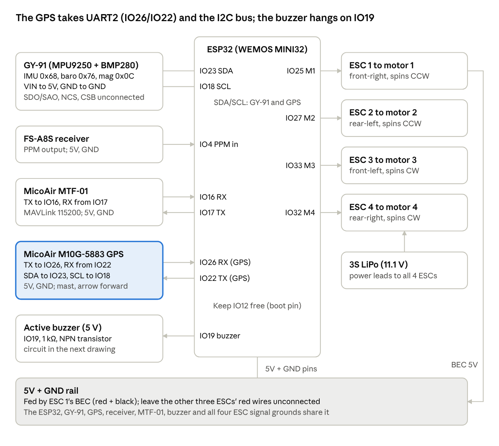

# ArduPilot on WEMOS D1 Mini ESP32 + GY-91 + MicoAir M10G-5883 GPS — Indoor Flow + Outdoor GPS Build Guide

Oct 20, 2026 · @lukas

## At a glance

This guide adds three things to **your flying WEMOS** (GY-91, MTF-01, FS-A8S, four 40A ESCs, 3S): a **MicoAir M10G-5883 GPS** (u-blox M10 + QMC5883L compass), a **buzzer**, and a **CH7 switch** that picks indoor flow or outdoor GPS. Everything else is your as-flown build, unchanged.

> **Status and safety.** The firmware in this guide was test-built at commit `9dd2e0f3` with Fixes 1–4 (34% flash free). The GPS, the second compass and the buzzer have **not flown yet** on this board. Keep props **off** until Part 8, fly tethered first, and never near people.

**Tested version.** `git describe` = `ArduPilot-4.6.0-beta1-9022-g9dd2e0f350` (commit `9dd2e0f3`), ESP-IDF 5.3, the same as your flying WEMOS. The boot log calls it `ArduCopter V4.8.0-dev (9dd2e0f3)`.

**How to use this guide:** work through the Parts in order. Each step ends with a **Check**; don't move on until it passes. In command blocks, a blank line separates commands, a line ending in `\` continues on the next line, and text after `#` is a comment.

**What changes from your as-flown WEMOS:**

| What | As-flown WEMOS | This build | Why |
| --- | --- | --- | --- |
| GPS | None | M10G-5883 on **SERIAL2** (UART2: **IO26** RX, **IO22** TX) | UART2 is the ESP32's last free hardware serial port |
| Compass | GY-91 AK8963 only | **GPS compass (QMC5883L) first**, GY-91 as backup | The GPS compass sits away from the motor wires |
| Position source | MTF-01 optical flow | **CH7 low** = flow (indoor), **CH7 high** = GPS (outdoor) | GPS doesn't work indoors |
| MTF-01 setting | `MAV4_OPTIONS 2` | **`MAV3_OPTIONS 2`** | SERIAL2 stops being a MAVLink port, so the MTF-01 moves from MAV4 to MAV3 (6.2) |
| Buzzer | None | Active buzzer on **IO19**, through a transistor | Ready-to-fly and arm/disarm beeps |
| `hwdef.dat` | As flown | **+2 lines**: UART2, and the QMC5883L driver | ESP32 builds leave that compass driver out unless asked |
| `defaults.parm` | As flown | **+ a GPS section** at the end | GPS port, the outdoor source sets, CH7, buzzer pin |

**How you'll know you have GPS lock:**

| Where | Shows | When |
| --- | --- | --- |
| The GPS's **blue LED** | Solid = searching, **blinks once a second = 3D fix** | Always, no setup |
| **Mission Planner HUD** (USB or WiFi) | `GPS: 3D Fix`, satellite count, HDOP | Any time it's connected (6.10) |
| **Part 2 sketch** | Fix type and satellites, printed every second | On the bench, before ArduPilot |
| **Buzzer** | The ready tune when every pre-arm check passes; with CH7 high and CH5 on Loiter, that includes GPS | Once per power-up (6.10) |
| ArduPilot's own checks | `PreArm: GPS 1: Bad fix`, `High GPS HDOP`; Loiter refused | Whenever CH7 picks GPS |

**Already flying the WEMOS? Your upgrade path:**

| Step | Do | Section |
| --- | --- | --- |
| 1 | Back up the whole flash and your two board files | 5.1, 4.1 |
| 2 | Wire the GPS and the buzzer | Part 1 |
| 3 | Run the Part 2 sketch: GPS data, compass and buzzer | 2.2 |
| 4 | Replace `hwdef.dat` and `defaults.parm`; Fixes 1–4 are already in your source tree | 4.1, 4.2, 4.7 |
| 5 | Build, check, flash **without** `erase_flash`. Your saved parameters stay, and the new GPS ones apply because you never saved them | Part 5 |
| 6 | Mission Planner: `MAV3_OPTIONS 2`, compass order and calibration, CH7, GPS check | Part 6 |
| 7 | Fly indoors as before (CH7 low), then outdoors on GPS | Part 8 |

## Part 1: Parts and wiring

The GPS adds six wires (5V, GND, TX, RX, SDA, SCL) and the buzzer adds three small parts. Everything you already wired stays where it is.

### 1.1 Parts

| Part | Notes |
| --- | --- |
| WEMOS D1 Mini ESP32 (MINI32) | Your flying board. Classic ESP32 (ESP32-WROOM-32, 4 MB flash) |
| GY-91 (MPU9250 + BMP280) | I2C. Its AK8963 compass becomes the backup compass |
| **MicoAir M10G-5883** | u-blox M10 GPS + QMC5883L compass. 5 V, about 30 mA, UART 3.3 V logic, default 115200 baud UBX, SH1.0 6-pin connector, 7 g |
| MicoAir MTF-01 | Optical flow + rangefinder, MAVLink on a UART |
| FlySky FS-A8S receiver + transmitter | PPM output, 8 channels. CH7 needs a switch assigned on the transmitter (6.9) |
| 4 × brushless ESC (40A, 5V BEC) + A2212 1400KV + 8045 props | As flown |
| 3S LiPo | 11.1V nominal |
| **Active buzzer, 5 V** | "Active" means it beeps by itself on plain DC. A passive buzzer stays silent here |
| **NPN transistor** (S8050 or 2N2222) + **1 kΩ resistor** | Switches the buzzer. The ESP32 pin can't power a buzzer on its own |
| GPS mast or standoff, about 5–10 cm | Lifts the GPS and its compass away from the power wires |
| Short jumper wires, open-cell foam, soft foam tape | Keep the GY-91 wires under about 10 cm |

A 3-pin active buzzer module (VCC, GND, I/O) can replace the buzzer, transistor and resistor: VCC to 5V, GND to GND, I/O to IO19.

### 1.2 Pin table

| Device pin | MINI32 pin | Notes |
| --- | --- | --- |
| GY-91 VIN / GND | 5V / GND | As flown |
| GY-91 3V3 | not connected | As flown |
| GY-91 SDA | **IO23** | I2C data, shared with the GPS compass |
| GY-91 SCL | **IO18** | I2C clock, shared with the GPS compass |
| GY-91 SDO/SAO, NCS, CSB | not connected | As flown |
| FS-A8S PPM | IO4 | As flown |
| FS-A8S + / − | 5V / GND | As flown |
| MTF-01 TX | IO16 | MINI32 RX, ArduPilot SERIAL3 |
| MTF-01 RX | IO17 | MINI32 TX |
| MTF-01 VCC / GND | 5V / GND | As flown |
| **GPS 5V / GND** | 5V / GND | 5 V only, never the 11.1 V battery |
| **GPS TX** | **IO26** | MINI32 RX, ArduPilot **SERIAL2** |
| **GPS RX** | **IO22** | MINI32 TX |
| **GPS SDA** | **IO23** | Same I2C bus as the GY-91 |
| **GPS SCL** | **IO18** | Same I2C bus as the GY-91 |
| **Buzzer driver** | **IO19** | Through 1 kΩ to the transistor's base (1.2 circuit below) |
| Motor 1–4 signal | IO25, IO27, IO33, IO32 | As flown |
| ESC signal grounds | GND | All four |
| 5V supply | 5V / GND | One ESC's BEC (red + black), as flown |

**Wire the GPS by the labels printed on its board** (5V, GND, TX, RX, SDA, SCL), not by wire colour or pin position: cables for SH1.0 connectors come in different orders.

**The pins in your wiring, in `hwdef.dat` (4.1) and in the Part 2 sketches must match:** I2C on SDA IO23 / SCL IO18, GPS on IO26 / IO22, buzzer on IO19.

**Wiring schematic**



Arrows show which way a signal travels; SDA and SCL carry data both ways and are shared by the GY-91 and the GPS. Every device's GND must join the same ground as the ESP32.

**Buzzer circuit**

&#91;embedded content: Buzzer circuit · IO19, 1 kΩ, NPN transistor, active buzzer on 5V\]

When IO19 goes high, the transistor connects the buzzer's − side to GND and it beeps; the buzzer's current comes from the 5V rail, not from the ESP32 pin. S8050 and 2N2222 have different pin orders, so check E, B and C on your transistor's datasheet.

### 1.3 Wiring rules

- **Never put anything with a pull-up on IO12.** It is an ESP32 boot pin. Also leave IO6–IO11 alone (internal flash), and IO2, IO14, IO15 (the SD-card lines in your `hwdef.dat`).
- **Mount the GPS on a mast or standoff, at least about 10 cm from the ESC and battery wires**, flat, antenna side up, with a clear view of the sky. Point the arrow on the GPS forward; calibration (6.6) fixes the rotation if it isn't.
- **Keep the GPS's I2C wires short** and away from the power leads. Twist SDA and SCL each with a GND wire if they must be longer than about 15 cm.
- **If the GPS sends no data** (Part 2 or Part 6), swap its TX and RX wires first. A forum user reported the RX/TX labels on this MicoAir module the wrong way round (Sources).
- **Never connect the buzzer straight to IO19.** A buzzer draws more current than an ESP32 pin should give; the transistor does the switching.
- **Keep the GY-91 wires short** (under about 10 cm) and away from the ESC and battery wires.
- **Cover the BMP280** with open-cell foam; don't seal it airtight.
- **USB and the BEC together:** the MINI32's 5V pin connects straight to USB 5V. During bench setup, unplug the BEC's red wire while USB is connected.
- **Mount the GY-91 chip side up, its Y axis forward, X axis right** (`ROTATION_NONE`), as flown.
- **Mount the MTF-01** underneath, lens straight down, as flown.

**Motor layout** (quad X, viewed from above, front at the top), as flown:

| Pin | Motor | Position | Spin | Motor Test button |
| --- | --- | --- | --- | --- |
| IO25 | 1 | front-right | CCW | A |
| IO27 | 2 | rear-left | CCW | C |
| IO33 | 3 | front-left | CW | D |
| IO32 | 4 | rear-right | CW | B |

**Check:** before powering up, confirm with a multimeter that 5V and GND aren't shorted, that the GPS's 5V pad reads 5 V (not 11 V) once the BEC is on, and that nothing is wired to IO12.

## Part 2: Bench tests before you build

Two Arduino sketches prove the hardware before ArduPilot is involved: 2.1 checks the GY-91 (as in your WEMOS guide), 2.2 checks the GPS, its compass and the buzzer. Arduino IDE, ESP32 board package (core 3.x), board **ESP32 Dev Module**, Serial Monitor at 115200. Afterwards, flash ArduPilot (Part 5).

### 2.1 GY-91 check

Put the board on a folded towel, away from the laptop, and don't touch it while it measures. The sketch uses the same pins as the `ESP32_I2CBUS` line in 4.1: SDA IO23, SCL IO18.

```cpp
// GY-91 check for ArduPilot on ESP32: I2C scan, chip ID, compass, and a still-noise test.
// Wiring: SDA = IO23, SCL = IO18 (the same pins as ESP32_I2CBUS in hwdef.dat). Board on a towel, don't touch it.
#include <Wire.h>

const int SDA_PIN = 23, SCL_PIN = 18;
const uint8_t ADDR = 0x68;          // MPU9250, SDO/SAO low
const uint8_t MAG  = 0x0C;          // AK8963 inside the MPU9250
const int N = 500;                  // samples per test (about 2.5 s)
uint8_t who = 0;

void writeReg(uint8_t reg, uint8_t val) {
  Wire.beginTransmission(ADDR);
  Wire.write(reg);
  Wire.write(val);
  Wire.endTransmission();
}

bool readFrom(uint8_t addr, uint8_t reg, uint8_t *buf, uint8_t n) {
  Wire.beginTransmission(addr);
  Wire.write(reg);
  if (Wire.endTransmission(false) != 0) return false;     // repeated start
  if (Wire.requestFrom(addr, n) != n) return false;
  for (uint8_t i = 0; i < n; i++) buf[i] = Wire.read();
  return true;
}

void setup() {
  Serial.begin(115200);
  delay(1000);
  Wire.begin(SDA_PIN, SCL_PIN, 400000);                    // 400 kHz like ArduPilot

  Serial.println("\n=== I2C scan ===");
  for (uint8_t a = 1; a < 127; a++) {
    Wire.beginTransmission(a);
    if (Wire.endTransmission() == 0) Serial.printf("  device at 0x%02X\n", a);
  }

  readFrom(ADDR, 0x75, &who, 1);                           // WHO_AM_I
  Serial.printf("WHO_AM_I = 0x%02X : ", who);
  if (who == 0x71 || who == 0x73)  Serial.println("MPU9250/9255 - IMU and compass OK for this guide");
  else if (who == 0x70)            Serial.println("MPU6500 - IMU works, but there is NO compass inside");
  else                             Serial.println("NOT an ID ArduPilot's Invensense driver expects (clone?)");

  writeReg(0x6B, 0x80);                                    // PWR_MGMT_1: reset
  delay(100);
  writeReg(0x6B, 0x01);                                    // wake up, gyro clock
  writeReg(0x1A, 0x03);                                    // CONFIG: gyro low-pass about 44 Hz
  writeReg(0x1B, 0x00);                                    // GYRO_CONFIG: +-250 dps = 131 per dps
  writeReg(0x1C, 0x00);                                    // ACCEL_CONFIG: +-2 g = 16384 per g
  writeReg(0x1D, 0x03);                                    // ACCEL_CONFIG2: accel low-pass about 44 Hz

  writeReg(0x37, 0x02);                                    // INT_PIN_CFG: I2C bypass on, as ArduPilot does
  delay(10);
  uint8_t wia = 0;
  bool magOk = readFrom(MAG, 0x00, &wia, 1);               // AK8963 WIA register
  Serial.printf("Compass AK8963 at 0x0C: %s, WIA = 0x%02X (expect 0x48)\n",
                magOk ? "answers" : "NOT found", wia);
  delay(200);
}

void loop() {
  double s[6] = {0}, q[6] = {0};
  int good = 0;
  for (int i = 0; i < N; i++) {
    uint8_t b[14];
    if (readFrom(ADDR, 0x3B, b, 14)) {                     // accel x,y,z, temperature, gyro x,y,z
      int16_t r[7];
      for (int k = 0; k < 7; k++) r[k] = (int16_t)((b[2 * k] << 8) | b[2 * k + 1]);
      double v[6] = { r[0] / 16.384, r[1] / 16.384, r[2] / 16.384,     // accel in milli-g
                      r[4] / 131.0,  r[5] / 131.0,  r[6] / 131.0 };   // gyro in deg/s
      for (int k = 0; k < 6; k++) { s[k] += v[k]; q[k] += v[k] * v[k]; }
      good++;
    }
    delay(5);
  }
  if (good < N / 2) {
    Serial.printf("Only %d/%d reads worked: check the wiring\n", good, N);
    delay(3000);
    return;
  }
  double m[6], sd[6];
  for (int k = 0; k < 6; k++) {
    m[k] = s[k] / good;
    sd[k] = sqrt(fmax(0.0, q[k] / good - m[k] * m[k]));
  }
  double accN = fmax(sd[0], sd[1]);
  double gyrN = fmax(fmax(sd[3], sd[4]), sd[5]);
  Serial.printf("\nreads OK %d/%d\n", good, N);
  Serial.printf("ACC  mean x %7.1f y %7.1f z %7.1f mg    noise x %5.2f y %5.2f z %5.2f mg\n",
                m[0], m[1], m[2], sd[0], sd[1], sd[2]);
  Serial.printf("GYRO mean x %6.2f y %6.2f z %6.2f dps   noise x %5.3f y %5.3f z %5.3f dps\n",
                m[3], m[4], m[5], sd[3], sd[4], sd[5]);
  Serial.printf("ACC noise %s   GYRO noise %s\n",
                accN <= 5 ? "GOOD" : accN <= 10 ? "OK" : "BAD",
                gyrN <= 0.15 ? "GOOD" : gyrN <= 0.3 ? "OK" : "BAD");
  delay(2000);
}
```

**A good GY-91 prints:** `device at 0x68` and `device at 0x76` in the scan, `WHO_AM_I = 0x71` (0x73 for an MPU9255), `Compass AK8963 at 0x0C: answers, WIA = 0x48`, and `ACC noise GOOD   GYRO noise GOOD`. With the GPS wired, the scan also shows `device at 0x0D`: that is the GPS compass, and it's expected.

| Result | Meaning |
| --- | --- |
| `WHO_AM_I` is 0x70 | An MPU6500: no compass. Use a GY-91 with a genuine MPU9250 |
| `WHO_AM_I` not 0x70 / 0x71 / 0x73 | ArduPilot won't detect this chip. Use another module |
| Compass `NOT found` with `WHO_AM_I` 0x71/0x73 | This module's compass is dead or missing; the GPS compass can carry on alone |
| Reads fail, or 0x68 / 0x76 missing from the scan | Wiring, pins that don't match the sketch, or the SDO/SAO pin (1.2) |
| BAD on the towel | The chip itself is noisy: replace the GY-91 |
| GOOD on the towel, BAD on the frame | The frame or mount shakes it: firmer foam, no wires tugging |

**Check:** `WHO_AM_I` 0x71 or 0x73, and GOOD (or at least OK) noise.

### 2.2 GPS, GPS compass and buzzer check

This sketch beeps the buzzer three times, scans the I2C bus for the GPS compass, finds the GPS's baud rate on IO26, then prints the fix type and satellite count every second. Indoors you'll see data but no fix: **for satellites, take it outdoors or put the GPS against an open window**. A cold start can take a few minutes.

```cpp
// GPS + compass + buzzer check for the WEMOS GPS build (no ArduPilot).
// Wiring: GPS TX -> IO26, GPS RX -> IO22, GPS SDA -> IO23, SCL -> IO18, 5V, GND. Buzzer driver on IO19.
// Serial Monitor at 115200. For satellites, take it outdoors or next to an open window.
#include <Wire.h>

const int SDA_PIN = 23, SCL_PIN = 18;     // same I2C pins as hwdef.dat
const int GPS_RX = 26, GPS_TX = 22;       // ESP32 side: RX listens to the GPS's TX
const int BUZZ_PIN = 19;                  // same pin as NTF_BUZZ_PIN
const uint8_t QMC = 0x0D;                 // QMC5883L compass inside the GPS
const long BAUDS[] = {115200, 230400, 38400, 9600};

HardwareSerial gps(2);
long gpsBaud = 0;

// UBX parser: counts good frames and reads fix type and satellites from NAV-PVT
uint8_t st = 0, cls = 0, id = 0, cka = 0, ckb = 0;
uint16_t len = 0, idx = 0;
uint8_t pl[100];
uint32_t ubxFrames = 0, pvtFrames = 0;
int fixType = -1, numSV = -1;
bool fixOK = false;

void beep(int n) {
  for (int i = 0; i < n; i++) {
    digitalWrite(BUZZ_PIN, HIGH);
    delay(150);
    digitalWrite(BUZZ_PIN, LOW);
    delay(150);
  }
}

bool readReg(uint8_t addr, uint8_t reg, uint8_t &v) {
  Wire.beginTransmission(addr);
  Wire.write(reg);
  if (Wire.endTransmission(false) != 0) return false;   // repeated start
  if (Wire.requestFrom(addr, (uint8_t)1) != 1) return false;
  v = Wire.read();
  return true;
}

void parse(uint8_t b) {
  switch (st) {
    case 0: if (b == 0xB5) st = 1; break;
    case 1: st = (b == 0x62) ? 2 : 0; break;
    case 2: cls = b; cka = b; ckb = cka; st = 3; break;
    case 3: id = b; cka += b; ckb += cka; st = 4; break;
    case 4: len = b; cka += b; ckb += cka; st = 5; break;
    case 5:
      len |= (uint16_t)b << 8; cka += b; ckb += cka; idx = 0;
      if (len > sizeof(pl)) st = 0;                 // too long for this check: skip it
      else st = (len > 0) ? 6 : 7;
      break;
    case 6: pl[idx++] = b; cka += b; ckb += cka; if (idx >= len) st = 7; break;
    case 7: st = (b == cka) ? 8 : 0; break;
    case 8:
      if (b == ckb) {
        ubxFrames++;
        if (cls == 0x01 && id == 0x07 && len >= 24) {  // NAV-PVT
          pvtFrames++;
          fixType = pl[20];
          fixOK = pl[21] & 0x01;
          numSV = pl[23];
        }
      }
      st = 0;
      break;
  }
}

void setup() {
  Serial.begin(115200);
  delay(1000);

  pinMode(BUZZ_PIN, OUTPUT);
  digitalWrite(BUZZ_PIN, LOW);
  Serial.println("\n=== Buzzer: you should hear 3 short beeps now ===");
  beep(3);

  Wire.begin(SDA_PIN, SCL_PIN, 400000);
  Serial.println("\n=== I2C scan (expect 0x0D GPS compass, 0x68 IMU, 0x76 barometer) ===");
  for (uint8_t a = 1; a < 127; a++) {
    Wire.beginTransmission(a);
    if (Wire.endTransmission() == 0)
      Serial.printf("  device at 0x%02X%s\n", a, a == QMC ? "  <- QMC5883L, the GPS compass" : "");
  }
  uint8_t chip = 0;
  bool qmcOk = readReg(QMC, 0x0D, chip);
  Serial.printf("GPS compass QMC5883L: %s, chip ID = 0x%02X (expect 0xFF)\n",
                qmcOk ? "answers" : "NOT found", chip);

  Serial.println("\n=== GPS serial: looking for data on IO26 ===");
  for (long b : BAUDS) {
    gps.end();
    gps.begin(b, SERIAL_8N1, GPS_RX, GPS_TX);
    uint32_t t0 = millis(), dollars = 0, before = ubxFrames;
    while (millis() - t0 < 2000) {
      while (gps.available()) {
        uint8_t c = gps.read();
        if (c == '$') dollars++;
        parse(c);
      }
    }
    if (ubxFrames > before || dollars > 5) {
      gpsBaud = b;
      Serial.printf("GPS data found at %ld baud (%s)\n", b, ubxFrames > before ? "UBX" : "NMEA");
      break;
    }
  }
  if (!gpsBaud) Serial.println("NO GPS data at any baud: check 5V and GND, then swap the TX and RX wires");
}

void loop() {
  if (!gpsBaud) { delay(1000); return; }
  uint32_t t0 = millis();
  while (millis() - t0 < 1000) {
    while (gps.available()) parse(gps.read());
  }
  const char *names[] = {"no fix", "dead reckoning", "2D fix", "3D fix", "GNSS + dead reckoning", "time only"};
  Serial.printf("UBX frames %lu, NAV-PVT %lu | ", (unsigned long)ubxFrames, (unsigned long)pvtFrames);
  if (pvtFrames == 0) Serial.println("no NAV-PVT yet (NMEA output? ArduPilot switches it to UBX itself)");
  else Serial.printf("fix: %s%s, satellites used: %d\n",
                     (fixType >= 0 && fixType <= 5) ? names[fixType] : "?", fixOK ? " (OK)" : "", numSV);
}
```

**A good result** (outdoors, after a few minutes):

```text
=== Buzzer: you should hear 3 short beeps now ===
=== I2C scan (expect 0x0D GPS compass, 0x68 IMU, 0x76 barometer) ===
  device at 0x0D  <- QMC5883L, the GPS compass
  device at 0x68
  device at 0x76
GPS compass QMC5883L: answers, chip ID = 0xFF (expect 0xFF)
GPS data found at 115200 baud (UBX)
UBX frames 412, NAV-PVT 206 | fix: 3D fix (OK), satellites used: 14
```

| What you see | Meaning | Do |
| --- | --- | --- |
| No beeps | Buzzer wiring, a passive buzzer, or the transistor's pins swapped | Check the circuit in 1.2; an active buzzer beeps on plain 5 V |
| `0x0D` missing, or `chip ID` not 0xFF | The GPS compass isn't on the bus | GPS SDA → IO23, SCL → IO18, and 5V/GND to the GPS |
| `NO GPS data at any baud` | TX/RX swapped or no power | Blue LED on? Then swap the GPS's TX and RX wires |
| `GPS data found` but `no fix` for more than about 5 minutes | No sky view | Outdoors, away from buildings; the blue LED blinks once a second once it has a fix |
| `3D fix (OK)`, satellites 10 or more | **GPS ready for ArduPilot** | Go on to Part 3 |
| `3D fix`, satellites under about 8 | Weak sky view or interference | More open space; keep the GPS away from the ESP32's antenna and power wires |

The sketch prints the satellites **used in the fix**; Mission Planner's `Sats` in Part 6 shows the same number.

**Check:** three beeps, `0x0D` with chip ID `0xFF`, GPS data found, and outdoors a `3D fix (OK)` with about 10 or more satellites.

## Part 3: Build environment (once)

**Already have `~/ardupilot_esp32_build/ardupilot` set up and building your WEMOS?** Skip to Part 4: nothing here changes for the GPS.

Use **Ubuntu 22.04 or newer** (native, or WSL2 on Windows). Check with `lsb_release -a`. Run these in order.

**3.1 System packages**

```bash
sudo apt update

sudo apt install -y git wget flex bison gperf cmake ninja-build ccache \
  libffi-dev libssl-dev dfu-util libusb-1.0-0 python3 python3-pip python3-venv
```

**3.2 Clone ArduPilot**

```bash
mkdir -p ~/ardupilot_esp32_build && cd ~/ardupilot_esp32_build

git clone --recursive https://github.com/ArduPilot/ardupilot.git    # several GB

cd ardupilot

git checkout 9dd2e0f3                               # the commit your flying drone was built from

git submodule update --init --recursive

git submodule status | grep -E '^[-+U]'             # must print nothing

Tools/environment_install/install-prereqs-ubuntu.sh -y
```

Then **close the terminal and open a new one**, so the new PATH loads.

**3.3 Fetch ESP-IDF 5.3**

```bash
cd ~/ardupilot_esp32_build/ardupilot

./Tools/scripts/esp32_get_idf.sh

git -C modules/esp_idf describe --tags               # must show v5.3.x

git -C modules/esp_idf submodule status --recursive | grep -E '^[-+U]'   # must print nothing
```

**3.4 Create the ESP-IDF Python environment** (in a fresh terminal)

```bash
which python3                                        # must be /usr/bin/python3

echo "VIRTUAL_ENV=$VIRTUAL_ENV"                      # must be empty

cd ~/ardupilot_esp32_build/ardupilot

./modules/esp_idf/install.sh                         # ends with "All done!"
```

**3.5 The `get_idf` shortcut.** Add this one line to the end of `~/.bashrc`, then open a new terminal:

```bash
alias get_idf='source ~/ardupilot_esp32_build/ardupilot/modules/esp_idf/export.sh'
```

Then, once:

```bash
cd ~/ardupilot_esp32_build/ardupilot

get_idf                                              # load the tools

python3 -m pip install empy==3.3.4 pexpect           # once per environment
```

**Check:** `get_idf` ends with `Done!`, and `which python3` now points into `~/.espressif/python_env/`. Run `get_idf` in every new terminal before building. `git describe` in the ardupilot folder should print `ArduPilot-4.6.0-beta1-9022-g9dd2e0f350`.

## Part 4: Board files and the ESP32 fixes

The GPS build uses **the same board folder as your flying WEMOS, `esp32lukas6050`**. Its two files get the GPS additions; nothing that is already there changes. The four source fixes are the same as in your WEMOS guide; every step is safe to run again.

### 4.0 Back up your flying board files first

This keeps a copy of the as-flown `hwdef.dat` and `defaults.parm`, so you can go back at any time.

```bash
cp -r ~/ardupilot_esp32_build/ardupilot/libraries/AP_HAL_ESP32/hwdef/esp32lukas6050 ~/esp32lukas6050_asflown_backup

ls ~/esp32lukas6050_asflown_backup                 # must list defaults.parm and hwdef.dat
```

To go back to the as-flown files later:

```bash
cp ~/esp32lukas6050_asflown_backup/* ~/ardupilot_esp32_build/ardupilot/libraries/AP_HAL_ESP32/hwdef/esp32lukas6050/
```

### 4.1 `hwdef.dat` with the GPS

Your working file with **two additions**: the QMC5883L compass driver (after the compass lines) and the third serial port for the GPS (after the UART lines). Change only `WIFI_SSID` and `WIFI_PWD` (8+ characters) if you want your own.

```bash
cd ~/ardupilot_esp32_build/ardupilot

mkdir -p libraries/AP_HAL_ESP32/hwdef/esp32lukas6050

cat > libraries/AP_HAL_ESP32/hwdef/esp32lukas6050/hwdef.dat <<'EOF'
# esp32lukas6050: WEMOS D1 Mini ESP32 (or DevKit) + MPU6050 (GY-521) or GY-91 on I2C, indoor MTF-01 build
define HAL_ESP32_BOARD_NAME "esp32-lukas-6050"

# --- I2C bus 0 on the standard ESP32 I2C pins (NOT IO12: it is a boot strapping pin)
#             Port       SDA         SCL          SPEED    INTERNAL SOFT
ESP32_I2CBUS  I2C_NUM_0  GPIO_NUM_23 GPIO_NUM_18  400*KHZ  false    false

# --- IMU: MPU6050, or the GY-91's MPU9250, at I2C address 0x68 (AD0/SAO low)
define HAL_INS_DEFAULT HAL_INS_MPU60XX_I2C
IMU Invensense I2C:0:0x68 ROTATION_NONE
define INS_MAX_INSTANCES 3

# --- Barometer: the GY-91's BMP280 (or a BMP280 module) at 0x76; boots fine without one
BARO BMP280 I2C:0:0x76
define HAL_BARO_ALLOW_INIT_NO_BARO 1

# --- Compass: none used (the GY-91's AK8963 stays off); an external I2C compass on the same bus is found by probing
define AP_COMPASS_PROBING_ENABLED 1
COMPASS AK8963:probe_mpu9250 I2C:0:0x0C ROTATION_NONE
define AP_COMPASS_AK8963_ENABLED 1

# --- the GPS module's QMC5883L compass (I2C 0x0D, same bus); ESP32 builds leave this driver out unless asked
define AP_COMPASS_QMC5883L_ENABLED 1

# --- no airspeed sensor
define AP_AIRSPEED_ENABLED 0

# --- ADC pins (battery monitor, optional)
ESP32_ADC_PIN ADC1_GPIO35_CHANNEL 11   35
ESP32_ADC_PIN ADC1_GPIO34_CHANNEL 11   34
ESP32_ADC_PIN ADC1_GPIO39_CHANNEL 11   39
ESP32_ADC_PIN ADC1_GPIO36_CHANNEL 11   36

# --- WiFi access point (change SSID and password)
define HAL_ESP32_WIFI 1
define WIFI_SSID "lukas-drone"
define WIFI_PWD "changeme123"

# --- motor outputs 1-4
ESP32_RCOUT GPIO_NUM_25
ESP32_RCOUT GPIO_NUM_27
ESP32_RCOUT GPIO_NUM_33
ESP32_RCOUT GPIO_NUM_32

# --- RC input (PPM) on IO4
define HAL_ESP32_RCIN GPIO_NUM_4
define HAL_ESP32_RMT_RX_PIN_NUMBER 4

# --- UARTs: SERIAL0 = USB, UART1 on IO16 (RX) / IO17 (TX) = MTF-01 (SERIAL3)
ESP32_SERIAL  UART_NUM_0  GPIO_NUM_3    GPIO_NUM_1
ESP32_SERIAL  UART_NUM_1  GPIO_NUM_16   GPIO_NUM_17

# --- GPS: MicoAir M10G-5883 on UART2, IO26 (RX) / IO22 (TX) = SERIAL2
ESP32_SERIAL  UART_NUM_2  GPIO_NUM_26   GPIO_NUM_22

# --- SD card / logging: same as the tested esp32lukas board (the MINI32 has no card; boot errors are harmless)
define AP_FILESYSTEM_ESP32_ENABLED 1
define HAL_ESP32_SDMMC 1
define HAL_ESP32_SDCARD 1
define LOGGER_MAVLINK_SUPPORT 1
define HAL_LOGGING_BACKENDS_DEFAULT 1

# --- optical flow (MTF-01): needs the esp32.h fix (4.3)
define AP_OPTICALFLOW_ENABLED 1
EOF
```

**Why the order of the `ESP32_SERIAL` lines matters.** ArduPilot's ESP32 code maps them by position, not by UART name:

| `ESP32_SERIAL` line | ArduPilot port | Used for |
| --- | --- | --- |
| 1st (UART0, IO3/IO1) | SERIAL0 | USB, Mission Planner |
| 2nd (UART1, IO16/IO17) | SERIAL3 | MTF-01 |
| 3rd (UART2, IO26/IO22) | **SERIAL2** | **GPS** |

SERIAL1 is the WiFi link. Keep the lines in this order, or the MTF-01 and the GPS swap ports.

### 4.2 `defaults.parm` with the GPS

Your working file with **one new section at the end** (from `# --- GPS`). Everything above it is unchanged.

```bash
cd ~/ardupilot_esp32_build/ardupilot

cat > libraries/AP_HAL_ESP32/hwdef/esp32lukas6050/defaults.parm <<'EOF'
# esp32lukas6050 defaults (MPU6050 or GY-91 + MTF-01, indoor). Applied to every never-saved parameter.

# --- loop rate: the ESP32 cannot run 400 Hz
SCHED_LOOP_RATE 150

# --- frame: quad X, plain PWM ESCs
FRAME_CLASS 1
FRAME_TYPE 1
MOT_PWM_TYPE 0
MOT_PWM_MIN 1000
MOT_PWM_MAX 2000

# --- flight modes on channel 5: Stabilize / AltHold / AltHold (Loiter stays OFF until Part 8)
FLTMODE_CH 5
FLTMODE1 0
FLTMODE2 0
FLTMODE3 0
FLTMODE4 2
FLTMODE5 2
FLTMODE6 2

# --- channel 6 = arm (up) / disarm (down); after boot flip it down, then up
RC6_OPTION 153

# --- never start ESC calibration from ArduPilot: it hangs the ESP32 (calibrate with the sketch)
ESC_CALIBRATION 9

# --- logging off: no SD card on the MINI32 (set 1 once you fit one)
LOG_BACKEND_TYPE 0

# --- failsafes
FS_THR_ENABLE 3
FS_THR_VALUE 975
FS_GCS_ENABLE 0
FS_EKF_ACTION 1

# --- no compass on either option (set COMPASS_ENABLE 1 and EK3_SRC1_YAW 1 if you add one)
COMPASS_ENABLE 0

# --- MTF-01 on SERIAL3 (IO16 RX / IO17 TX)
SERIAL3_PROTOCOL 1
SERIAL3_BAUD 115
FLOW_TYPE 5
RNGFND1_TYPE 10
RNGFND1_MIN 0.01
RNGFND1_MAX 8
RNGFND1_ORIENT 25

# --- EKF3 sources for INDOOR flight: flow velocity, rangefinder height, no yaw source
EK3_SRC_OPTIONS 0
EK3_SRC1_POSXY 0
EK3_SRC1_VELXY 5
EK3_SRC1_POSZ 2
EK3_SRC1_VELZ 0
EK3_SRC1_YAW 1

# --- GPS: MicoAir M10G-5883 on SERIAL2 (IO26 RX / IO22 TX); ArduPilot finds and sets up the u-blox itself
SERIAL2_PROTOCOL 5

# --- EKF3 source sets 2 and 3 = OUTDOOR GPS (CH7 high or middle picks them; CH7 low = set 1, the indoor flow set above)
EK3_SRC2_POSXY 3
EK3_SRC2_VELXY 3
EK3_SRC2_POSZ 1
EK3_SRC2_VELZ 3
EK3_SRC2_YAW 1
EK3_SRC3_POSXY 3
EK3_SRC3_VELXY 3
EK3_SRC3_POSZ 1
EK3_SRC3_VELZ 3
EK3_SRC3_YAW 1

# --- channel 7 = EKF source switch: low = indoor flow (set 1), high = outdoor GPS (set 3)
RC7_OPTION 90

# --- buzzer on IO19 (drives a transistor; the buzzer itself runs on 5V)
NTF_BUZZ_PIN 19
EOF
```

**What the new lines do:**

| Line | Value | Meaning |
| --- | --- | --- |
| `SERIAL2_PROTOCOL` | 5 | SERIAL2 talks GPS instead of MAVLink. `GPS1_TYPE` stays at its default 1 (auto), so ArduPilot finds the u-blox and sets its baud rate and messages itself |
| `EK3_SRC2_*`, `EK3_SRC3_*` | POSXY 3, VELXY 3, POSZ 1, VELZ 3, YAW 1 | Outdoor set: position and velocity from GPS, height from the barometer, heading from the compass |
| `RC7_OPTION` | 90 | CH7 picks the EKF source set |
| `NTF_BUZZ_PIN` | 19 | The buzzer driver pin (1.2) |

**Why sets 2 and 3 are the same.** ArduPilot's source switch has three positions:

| CH7 position | Source set | Here |
| --- | --- | --- |
| Low (under about 1200) | 1 | **Indoor**: MTF-01 flow, rangefinder height |
| Middle (3-position switch only) | 2 | **Outdoor**: GPS |
| High (over about 1800) | 3 | **Outdoor**: GPS |

A 2-position switch jumps from low straight to high, so GPS goes in set 3; set 2 holds the same values, so a 3-position switch can never land on an empty set.

**Comments older than the build** are left as they are, as in your WEMOS file: the compass comments say no compass is used (6.2 turns it on), the EKF3 comment says "no yaw source" although the value is compass yaw, and the flight-mode comment predates Loiter on `FLTMODE6` (Part 8).

### 4.3 Fix 1: turn optical flow back on

```bash
cd ~/ardupilot_esp32_build/ardupilot

F=libraries/AP_HAL/board/esp32.h

grep -q "#ifndef AP_OPTICALFLOW_ENABLED" $F || \
  sed -i 's/^#define AP_OPTICALFLOW_ENABLED 0$/#ifndef AP_OPTICALFLOW_ENABLED\n#define AP_OPTICALFLOW_ENABLED 0\n#endif/' $F

grep -n -B1 -A1 "AP_OPTICALFLOW_ENABLED" $F
```

**Check:** three lines in a row: `#ifndef AP_OPTICALFLOW_ENABLED`, `#define AP_OPTICALFLOW_ENABLED 0`, `#endif`.

### 4.4 Fix 2: motors stuck at idle

```bash
cd ~/ardupilot_esp32_build/ardupilot

python3 - <<'EOF'
p = "ArduCopter/takeoff_check.cpp"
s = open(p).read()
if "no ESC telemetry: nothing to check" in s:
    print("already fixed - nothing to do")
else:
    a = "#if HAL_WITH_ESC_TELEM && FRAME_CONFIG != HELI_FRAME"
    b = "        takeoff_check_state.warning_ms = now_ms;\n"
    c = "    const bool motor_check_passed = motors_takeoff_check(g2.takeoff_rpm_min, g2.takeoff_rpm_max);\n"
    assert s.count(a) == 1 and s.count(b) == 1 and s.count(c) == 1, "file differs from expected - stop and check"
    s = s.replace(a, "#if FRAME_CONFIG != HELI_FRAME")
    s = s.replace(b, "#if HAL_WITH_ESC_TELEM\n" + b + "#endif\n")
    s = s.replace(c, "#if HAL_WITH_ESC_TELEM\n" + c + "#else\n    // no ESC telemetry: nothing to check\n    const bool motor_check_passed = true;\n#endif\n")
    open(p, "w").write(s)
    print("fixed")
EOF

grep -n "#if\|#else\|no ESC telemetry" ArduCopter/takeoff_check.cpp
```

**Check:** it prints `fixed` (or `already fixed - nothing to do`), and the grep shows `#if FRAME_CONFIG != HELI_FRAME`, two `#if HAL_WITH_ESC_TELEM`, one `#else` and `// no ESC telemetry: nothing to check`.

### 4.5 Fix 3: let the I2C IMU reader run on time

With the GPS compass on the same I2C bus, this fix matters even more: the bus now carries three chips.

```bash
cd ~/ardupilot_esp32_build/ardupilot

sed -i 's/I2C_PRIORITY = 5;/I2C_PRIORITY = 24;/' libraries/AP_HAL_ESP32/Scheduler.h

grep -n "I2C_PRIORITY = 24" libraries/AP_HAL_ESP32/Scheduler.h
```

**Check:** the grep prints exactly one line.

### 4.6 Fix 4: ESC calibration from Mission Planner

```bash
cd ~/ardupilot_esp32_build/ardupilot

python3 - <<'EOF'
p = "ArduCopter/esc_calibration.cpp"
s = open(p).read()
if "ESP32 FIX: parameter saving" in s:
    print("already fixed - nothing to do")
else:
    a = "    // clear esc flag for next time\n    g.esc_calibrate.set_and_save(ESCCAL_NONE);\n\n    if (motors->is_normal_pwm_type()) {\n"
    assert s.count(a) == 1, "file differs from expected - stop and check"
    b = ("    // clear esc flag for next time\n"
         "    g.esc_calibrate.set_and_save(ESCCAL_NONE);\n"
         "#if CONFIG_HAL_BOARD == HAL_BOARD_ESP32\n"
         "    // ESP32 FIX: parameter saving and flash writing only run after setup()\n"
         "    // ends, and calibration never returns, so store the cleared flag now\n"
         "    g.esc_calibrate.save_sync(true, false);\n"
         "    for (uint32_t i = 0; i < HAL_STORAGE_SIZE / 8 + 1; i++) {\n"
         "        hal.storage->_timer_tick();\n"
         "    }\n"
         "#endif\n"
         "\n    if (motors->is_normal_pwm_type()) {\n")
    open(p, "w").write(s.replace(a, b))
    print("fixed")
EOF

grep -n "ESP32 FIX" ArduCopter/esc_calibration.cpp
```

**Check:** it prints `fixed` (or `already fixed - nothing to do`), and the grep shows one line.

### 4.7 Check the parameter names

A misspelled name in `defaults.parm` is silently ignored, so check them against ArduCopter's parameter list:

```bash
cd ~/ardupilot_esp32_build/ardupilot/Tools/autotest/param_metadata

python3 param_parse.py --vehicle ArduCopter --format json > /dev/null   # creates apm.pdef.json

cd ~/ardupilot_esp32_build/ardupilot

python3 - <<'EOF'
import json
d = json.load(open('Tools/autotest/param_metadata/apm.pdef.json'))
names = {k for grp in d.values() for k in grp}
bad = [l.split()[0] for l in open('libraries/AP_HAL_ESP32/hwdef/esp32lukas6050/defaults.parm')
       if l.split('#')[0].strip() and l.split()[0] not in names]
print("Unknown parameters:", bad if bad else "none")
EOF
```

**Check:** it prints `Unknown parameters: none` (it did on the test build at `9dd2e0f3`).

## Part 5: Back up, build, check and flash

### 5.1 Back up the drone that already flies

Copy the whole flash to your PC first: firmware, calibrations and every saved parameter. `read_flash` only copies; it doesn't change the board. Close Mission Planner first.

```bash
esptool.py --chip esp32 -p /dev/ttyUSB0 read_flash 0 0x400000 wemos_flying_backup.bin
```

To put the board back exactly as it was, at any time:

```bash
esptool.py --chip esp32 -p /dev/ttyUSB0 write_flash 0x0 wemos_flying_backup.bin
```

### 5.2 Build

The `configure` step is needed this time because `hwdef.dat` changed.

```bash
cd ~/ardupilot_esp32_build/ardupilot

get_idf                                       # load the ESP32 tools

./waf configure --board=esp32lukas6050        # re-reads hwdef.dat

./waf copter                                  # build ArduCopter
```

**Check:** it ends with `'copter' finished successfully` and an `ardupilot.bin binary size` line showing about **34% free** (the test build: `0x1030e0 bytes (34%) free`). If `waf` stops at `esp-idf_showinc` with `constraints ... doesn't exist`, run `export IDF_PYTHON_CHECK_CONSTRAINTS=no`, delete `build/esp32lukas6050/esp-idf_build`, and build again.

### 5.3 Confirm the sensors, the GPS port and all fixes are inside

```bash
cd ~/ardupilot_esp32_build/ardupilot

grep -o "\.sda=GPIO_NUM_[0-9]*, \.scl=GPIO_NUM_[0-9]*" build/esp32lukas6050/hwdef.h   # I2C pins

grep -A3 "define HAL_ESP32_UART_DEVICES" build/esp32lukas6050/hwdef.h                 # the three serial ports

grep "HAL_INS_PROBE1" build/esp32lukas6050/hwdef.h                                    # IMU on I2C bus 0, 0x68

grep -o "AK8963::probe_mpu9250([^;]*" build/esp32lukas6050/hwdef.h                     # GY-91 compass

nm -C build/esp32lukas6050/esp-idf_build/ardupilot.elf | grep -c "AP_Compass_QMC5883L::"   # GPS compass driver

nm -C build/esp32lukas6050/esp-idf_build/ardupilot.elf | grep -c "AP_GPS_UBLOX::"         # u-blox GPS driver

nm -C build/esp32lukas6050/esp-idf_build/ardupilot.elf | grep -c AP_OpticalFlow_MAV   # Fix 1

nm -C -S build/esp32lukas6050/esp-idf_build/ardupilot.elf | grep " Copter::takeoff_check()"   # Fix 2

grep -c "I2C_PRIORITY = 24" libraries/AP_HAL_ESP32/Scheduler.h                       # Fix 3

grep -c "ESP32 FIX" ArduCopter/esc_calibration.cpp                                    # Fix 4

grep -c "defaults.parm" build/esp32lukas6050/ap_romfs_embedded.h                      # defaults embedded
```

**Check** (values from the test build of these exact files at `9dd2e0f3`):

| Line | Must show |
| --- | --- |
| I2C pins | `.sda=GPIO_NUM_23, .scl=GPIO_NUM_18` |
| Serial ports | Three lines: `UART_NUM_0` rx 3 / tx 1, `UART_NUM_1` rx 16 / tx 17, **`UART_NUM_2` rx 26 / tx 22**. Only two lines: 4.1 wasn't written, or `configure` wasn't run |
| `HAL_INS_PROBE1` | `AP_InertialSensor_Invensense::probe(*this,GET_I2C_DEVICE(0,0x68),ROTATION_NONE)` |
| GY-91 compass | `AK8963::probe_mpu9250(GET_I2C_DEVICE(0,0x0c),ROTATION_NONE)` |
| `AP_Compass_QMC5883L::` | **8**. A 0 means the QMC5883L line in 4.1 is missing |
| `AP_GPS_UBLOX::` | 46 (any number above 0) |
| `AP_OpticalFlow_MAV` | 8. A 0 means 4.3 didn't run |
| `Copter::takeoff_check()` | Size `000000a4`. `00000005` means 4.4 didn't run |
| `I2C_PRIORITY = 24` | 1 |
| `ESP32 FIX` | 1 |
| `defaults.parm` | 1 |

### 5.4 Flash

Flash with **nothing but USB connected**. Close Mission Planner and any serial monitor first.

| Situation | Do |
| --- | --- |
| **Your flying drone, adding the GPS** | **Skip `erase_flash`.** Your saved parameters and calibrations stay. The new GPS lines in `defaults.parm` still apply, because you never saved those parameters |
| New board, or one that had other firmware | Run `erase_flash` first, so `defaults.parm` applies to every parameter |

**On Windows with WSL2**, first pass the USB port to Ubuntu. In an **Admin PowerShell**:

```powershell
usbipd list                                               # find the board (CP2104 = 10c4:ea60); note its BUSID, e.g. 1-1

usbipd bind --busid 1-1                                   # once per board

usbipd attach --wsl --busid 1-1                           # every time you plug it in; keep Ubuntu open
```

Then in **Ubuntu**:

```bash
ls /dev/ttyUSB* /dev/ttyACM* 2>/dev/null                  # find the port, e.g. /dev/ttyUSB0

cd ~/ardupilot_esp32_build/ardupilot

get_idf

esptool.py --chip esp32 -p /dev/ttyUSB0 erase_flash       # new board only (see the table above)

ESPPORT=/dev/ttyUSB0 ESPBAUD=921600 ./waf copter --upload
```

**Check:** it ends with `Hash of data verified` and `Hard resetting`. To get the Windows COM port back for Mission Planner: `usbipd detach --busid 1-1`.

**If flashing won't start** (`Failed to connect`): jumper **IO0 to GND**, press and release **RST**, then:

```bash
cd ~/ardupilot_esp32_build/ardupilot/build/esp32lukas6050/esp-idf_build

esptool.py --chip esp32 -p /dev/ttyUSB0 --before no_reset -b 460800 write_flash @flash_args
```

Remove the jumper and press RST to start the firmware.

### 5.5 Check that it boots

Open a serial monitor at 115200 and press **RST**.

| In the log | Meaning |
| --- | --- |
| `Init ArduCopter V4.8.0-dev (9dd2e0f3)` | ArduPilot started |
| `sdmmc_...` errors, `sdcard is not mounted` | Harmless: the MINI32 has no SD card |
| `loop_rate: actual: ...Hz, expected: 150Hz` every 10 s | **Startup finished**, the main loop runs |
| `Config Error: INS: unable to initialise driver` | IMU not found: wiring or I2C pins (1.2) |
| A reset that repeats (`rst:0xc`, `0x7`, `0x8`, `0xf`) | Crash, watchdog or brownout: see Troubleshooting |

With the buzzer wired, you hear its startup beep once the gyros are calibrated (keep the drone still).

**Check:** the `loop_rate` line appears and the log stops resetting.

## Part 6: Mission Planner setup and calibration

Props **off** for this whole Part. Reboot the board (press RST) after any group of parameter changes. On your flying drone flashed without `erase_flash`, the as-flown settings are already in place: just check them, and do the GPS steps.

### 6.1 Connect

- **USB (best for setup):** the board's COM port at **115200** (not AUTO). In **Config → Planner**, **untick Reset on USB connect (DTR)**.
- **WiFi:** join the `lukas-drone` network, then connect with **TCP**, host **192.168.4.1**, port **5760**. Handy outdoors for watching the GPS.

**Check:** the HUD shows **DISARMED**, and the parameter download finishes.

### 6.2 Set the parameters that need a reboot first

In **Config → Full Parameter List**, set these and **Write Params**, then reboot:

| Parameter | Value | Why |
| --- | --- | --- |
| `COMPASS_ENABLE` | 1 | Turns the compasses on (already 1 on your flying drone) |
| **`MAV3_OPTIONS`** | **2** | **Changed from your WEMOS.** Don't forward MAVLink to or from the MTF-01. **First check `MAV3_DEVID` = 66310** (SERIAL3). MAV numbers count the SERIAL ports set to MAVLink, in order: SERIAL0 (USB) = MAV1, SERIAL1 (WiFi) = MAV2, **SERIAL3 (MTF-01) = MAV3**. SERIAL2 is now the GPS, so it no longer takes a MAV number |
| `MAV4_OPTIONS` | leave as it is | No port uses MAV4 any more, so its old value does nothing |
| `SERIAL3_OPTIONS` | 0 | As flown |
| `FLOW_ORIENT_YAW` | your flown value | As flown (6.8 if new) |

Then confirm these came from `defaults.parm`:

| Parameter | Must read |
| --- | --- |
| `SERIAL2_PROTOCOL` | 5 (GPS) |
| `GPS1_TYPE` | 1 (auto) |
| `EK3_SRC1_POSXY`, `EK3_SRC1_VELXY` | 0 and 5 (indoor flow, as flown) |
| `EK3_SRC3_POSXY`, `EK3_SRC3_VELXY`, `EK3_SRC3_POSZ` | 3, 3, 1 (outdoor GPS) |
| `RC7_OPTION` | 90 |
| `NTF_BUZZ_PIN` | 19 |

If one of them shows a different value, it had been saved before and the default can't override it: type the value from 4.2 and **Write Params**.

**Initial Tune Parameters:** already done on your flying drone. On a new board, set them as in your WEMOS guide (8-inch props, 3 cells, 4.2 V / 3.3 V).

### 6.3 Were all the sensors found?

In **Config → Full Parameter List**, after the reboot:

| Parameter | Good |
| --- | --- |
| `INS_ACC_ID`, `INS_GYR_ID` | Any non-zero number |
| `BARO1_DEVID` | **226817**: BMP280, address 0x76, I2C bus 0 |
| `COMPASS_DEV_ID`, `COMPASS_DEV_ID2` | One of them **855297** = hex `0x0D0D01`: QMC5883L (type `0D`), address `0x0D`, I2C bus 0. The other **265217** = hex `0x040C01`: the GY-91's AK8963 |

**Is the GPS detected?** Indoors too, the HUD changes from `GPS: No GPS` to **`GPS: No Fix`** within about a minute of booting, and in **Data → Status** `gpsstatus` goes from 0 to 1 or more. The **Messages** tab may also show `GPS 1: detected u-blox`, but only if Mission Planner was already connected when it happened.

**Put the GPS compass first.** ArduPilot remembers the compass order. Your flying drone saved the AK8963 as compass 1, so the new QMC5883L lands in second place:

1. **Setup → Mandatory Hardware → Compass.**
2. In the priority list, select the **QMC5883L** (`855297`) and move it to the **top** with the up arrow. Keep **Use Compass** ticked for both; the QMC5883L should show as **External**.
3. Click **Reboot** (or press RST).

**Check:** after the reboot, `COMPASS_PRIO1_ID` = 855297 and `COMPASS_PRIO2_ID` = 265217.

### 6.4 Accelerometer and level

As flown: **power up with the drone sitting still**; **Setup → Mandatory Hardware → Accel Calibration**: **Calibrate Accel**, then **Calibrate Level**. Skip it if nothing moved on the frame.

### 6.5 Orientation and IMU still check

As in your WEMOS guide: nose down → HUD pitches down, left side up → HUD rolls right. In **Data → Status** on a level table: roll and pitch steady within about ±1°, `ax`/`ay` near 0, `az` near −1000.

### 6.6 Compass calibration and heading check

Both compasses are calibrated together. The GPS compass's rotation is found automatically: `COMPASS_AUTO_ROT` stays at its default 2 (check and fix).

1. **Setup → Mandatory Hardware → Compass.** Both compasses are listed, the QMC5883L first.
2. Take the drone **outdoors, away from cars, steel and the laptop**. Over WiFi is easiest, so no cable gets in the way.
3. Click **Start** under Onboard Mag Calibration and rotate the drone slowly through every axis until **both** bars complete.
4. When it reports success, **reboot**.
5. **Heading check:** compare the HUD heading with a phone compass, nose pointing N, E, S and W. **Check:** within about 15° at each.

| Result | Meaning | Do |
| --- | --- | --- |
| Both bars complete, heading within 15° | Good | Go on |
| A message that the compass rotation was changed | `COMPASS_AUTO_ROT` found the GPS mounted turned; that's fine | Reboot and redo the heading check |
| One bar never completes | Steel nearby, or that compass is faulty | Move away from metal; if it's the AK8963, untick its **Use Compass** and carry on with the GPS compass |
| Heading off by 90° or 180° | GY-91 or GPS turned on the frame | Orientation check (6.5); GPS arrow forward; calibrate again |

### 6.7 Barometer check

As flown: `press_abs` about 1000–1015 hPa near sea level, dropping about 0.2 hPa when you lift the drone 1.5 m. Outdoors the barometer gives the height (`EK3_SRC3_POSZ 1`), so this check matters more now.

### 6.8 MTF-01 checks

As in your WEMOS guide (MicoAssistant `mav_apm`, data check, tilt test, move test), with one difference: the MTF-01's MAVLink setting is now **`MAV3_OPTIONS 2`** (6.2). Do these with **CH7 low** (indoor source set).

### 6.9 Radio, flight modes, arm switch and the CH7 source switch

| Step | How | Check |
| --- | --- | --- |
| Radio | **Setup → Mandatory Hardware → Radio Calibration**, every stick and switch through its range | Bars 1–4 follow the sticks |
| Flight modes | **Setup → Flight Modes**: flip CH5 | Stabilize / AltHold (Loiter added in Part 8) |
| Arm switch | **Data → Status → `ch6in`** | Below 1200 and above 1800 |
| **CH7 source switch** | On the transmitter, assign a **2-position switch to channel 7** (on FlySky radios: Functions setup → Aux. channels). Redo Radio Calibration so bar 7 moves | **`ch7in` below 1200** in one position and **above 1800** in the other |
| **Source messages** | Flip CH7 and watch the **Messages** tab | Low: `Using EKF Source Set 1`. High: `Using EKF Source Set 3` |

**Rule:** choose the source on the ground before you arm, **low indoors, high outdoors**. Don't flip CH7 in flight until you've tested it as in 8.4.

### 6.10 GPS lock and satellite check (outdoors)

Take the drone outside, props off, CH7 **high**, and wait. A cold start takes about 1–5 minutes; later starts are faster.

| Where | Searching | Ready for Loiter |
| --- | --- | --- |
| GPS **blue LED** | Solid | **Blinks once a second** (3D fix) |
| Mission Planner HUD, `GPS:` | `No Fix` or `2D Fix` | **`3D Fix`** (or better) |
| HUD `Sats` | Under about 8 | **About 10 or more** |
| HUD `HDOP` | Above 1.4 | **About 1.2 or lower** (arming refuses above `GPS_HDOP_GOOD` = 1.4) |
| Messages | `PreArm: GPS 1: Bad fix`, `AHRS: waiting for home`, `High GPS HDOP` | None of these; home appears on the map |

**What the buzzer tells you:**

| You hear | Meaning |
| --- | --- |
| A short tune a few seconds after power-up | Gyros calibrated; keep the drone still until then |
| The **ready tune**, once | Every pre-arm check passed. It plays once per power-up |
| Double beep | Armed |
| Single beep | Disarmed, or arming refused (read the PreArm message) |
| Single beeps that repeat | Battery failsafe |

**Making the ready tune mean "GPS ready":** pre-arm only checks the GPS when the selected source set uses GPS **and** the flight mode needs a position. So once Loiter is on CH5 (8.3), power up outdoors with **CH7 high and CH5 on Loiter**: the ready tune then only plays once the GPS has a good enough fix. With CH5 on Stabilize or AltHold it plays without a fix, and only means the other checks passed.

**Check:** outdoors, the blue LED blinks, the HUD shows `3D Fix` with about 10 or more satellites and HDOP about 1.2 or lower, and home is set on the map.

## Part 7: ESC calibration

**Your flying drone's ESCs are already calibrated: skip this Part.** It is here, unchanged from your WEMOS guide, for a new build or new ESCs. The ESCs must learn that 1000 µs means stop and 2000 µs means full. With Fix 4, Mission Planner's **Calibrate ESCs** works on this board; the sketch in 7.3 is the backup.

### 7.1 Get ready (props OFF)

1. **Hardware:** all **props off**. The four ESC signal wires on IO25, IO27, IO33 and IO32, their grounds on ESP32 GND, and **one ESC's red BEC wire on the ESP32's 5V**: the battery must power the ESP32, because USB will be unplugged.
2. **Mission Planner** (USB): check `MOT_PWM_MIN` = 1000 and `MOT_PWM_MAX` = 2000.
3. **Setup → Mandatory Hardware → ESC Calibration → Calibrate ESCs.** This sets `ESC_CALIBRATION` to 3 for the next power-up.

### 7.2 Calibrate (hardware only)

1. Unplug **USB**, then unplug the **battery**. Everything is off.
2. Plug in the **battery only** (no USB), touch nothing, and listen:

| Time after plugging in | You hear | Meaning |
| --- | --- | --- |
| About 1 s | ESC startup tune | ESCs powered |
| About 3–4 s | **beep-beep** | The ESP32 is sending full throttle; the ESCs store it as the maximum |
| About 5 s later | **3 short beeps, then 1 long beep** | Minimum stored: **calibrated** |

3. Unplug the battery.

**If the motors spin instead of beeping, unplug the battery at once.** Mission Planner shows nothing during calibration: on ESP32 MAVLink only starts after startup, and calibration happens inside startup. The buzzer may stay silent too, for the same reason.

**Check:** plug USB back in and connect: `ESC_CALIBRATION` now reads **0**. Then **Setup → Optional Hardware → Motor Test** at 10%: every motor starts and spins smoothly.

### 7.3 Backup: calibrate with a sketch

Arduino IDE, **ESP32 core 3.x**, board **ESP32 Dev Module**, Serial Monitor 115200 with line ending **Newline**. Press Enter in the input box to answer. Afterwards, flash ArduPilot back (5.4, without `erase_flash`).

```cpp
// GUIDED ESC CALIBRATION for 4 ESCs - no ArduPilot. PROPS OFF.
// To start over: unplug the battery, press the ESP32's EN/RST button.

const int ESC_PINS[4] = {25, 27, 33, 32};   // motor 1-4 pins from the board file

void setPulse(int us) {
  for (int i = 0; i < 4; i++) {
    ledcWrite(ESC_PINS[i], (uint32_t)us * 65535 / 20000);   // 50 Hz, pulse width in us
  }
  Serial.printf("   [signal to ESCs = %d us]\n", us);
}

void waitEnter() {
  while (Serial.available()) Serial.read();               // clear old input
  while (!Serial.available()) delay(10);                  // wait for Enter
  while (Serial.available()) Serial.read();
}

void setup() {
  Serial.begin(115200);
  delay(1000);
  for (int i = 0; i < 4; i++) ledcAttach(ESC_PINS[i], 50, 16);
  setPulse(1000);                                         // safe start

  Serial.println("\n=========== ESC CALIBRATION ===========");
  Serial.println("STEP 1: Check ALL of these:");
  Serial.println("  - PROPS OFF");
  Serial.println("  - Battery UNPLUGGED");
  Serial.println("  - ESC signal wires on IO25, IO27, IO33, IO32");
  Serial.println("  - ESC black/brown signal ground wires on ESP32 GND");
  Serial.println("  - ESC red wires NOT connected (ESP32 runs from USB)");
  Serial.println(">> Press Enter when ready.");
  waitEnter();

  setPulse(2000);                                         // full throttle BEFORE the ESCs get power
  Serial.println("\nSTEP 2: Sending FULL throttle now.");
  Serial.println(">> PLUG IN THE BATTERY NOW.");
  Serial.println("   You will hear: startup tune, then 'beep-beep'.");
  Serial.println(">> Press Enter AS SOON AS you hear 'beep-beep' (within 2-3 seconds!).");
  waitEnter();

  setPulse(1000);                                         // minimum throttle -> ESC stores the range
  Serial.println("\nSTEP 3: Sending MINIMUM throttle now.");
  Serial.println("   You should hear: 3 beeps (3S battery), then 1 long beep = CALIBRATED.");
  Serial.println("   If you hear a repeating series of DIFFERENT tones instead, you were too slow:");
  Serial.println("   unplug the battery, press EN/RST, and start again.");
  Serial.println(">> Press Enter after the long beep.");
  waitEnter();

  Serial.println("\nSTEP 4: Test. Motors WILL SPIN (props must be OFF).");
  Serial.println(">> Press Enter to start the test.");
  waitEnter();
  int steps[] = {1100, 1200, 1300, 1400, 1500};
  for (int i = 0; i < 5; i++) {
    setPulse(steps[i]);
    Serial.println("   all 4 motors should be spinning, and getting faster");
    delay(2000);
  }
  setPulse(1000);                                         // stop motors

  Serial.println("\nSTEP 5: DONE. Motors stopped.");
  Serial.println(">> UNPLUG THE BATTERY.");
  Serial.println("   The ESCs keep this calibration. You can flash ArduPilot back now.");
}

void loop() {
  // nothing - the signal stays at 1000 us (motors stopped)
}
```

### 7.4 ESC beep codes

| You hear | Meaning | Fix |
| --- | --- | --- |
| One beep about every 2 s | No signal | Signal wire on the right pin; ESC signal ground to ESP32 GND |
| Fast continuous beeping | Throttle not at minimum | Calibrate (7.2) |
| Double beeps repeating | Battery voltage out of range | Fully charged pack |

These come from the ESCs and motors, not from the new buzzer on IO19.

## Part 8: Bench test, indoor flight, then outdoor GPS flight

### 8.1 Bench test (props OFF)

Work through every item; fix any failure before moving on.

- Boot log shows the `loop_rate` line and stops resetting (5.5)
- `INS_ACC_ID`, `BARO1_DEVID` non-zero; compasses **855297** (QMC5883L, priority 1) and **265217** (AK8963, priority 2) (6.3)
- HUD shows `GPS: No Fix` (or better), so the GPS is detected (6.3)
- HUD level and steady; orientation check passes (6.5)
- Compasses calibrated; HUD heading within about 15° of a phone (6.6)
- Radio bars correct; CH5 switches modes; CH6 arms; **CH7 low → `Using EKF Source Set 1`, high → `Using EKF Source Set 3`** (6.9)
- Transmitter off → Mission Planner reports a radio failsafe
- With **CH7 low**: MTF-01 data, tilt test and move test pass (6.8)
- Buzzer: startup tune after power-up; double beep on arm, single beep on disarm
- **Motor Test** at 10%: A = front-right, B = rear-right, C = rear-left, D = front-left, spinning the way the motor table says
- **Arm** (CH6 down, then up): HUD **ARMED**, `ch1out`–`ch4out` about **1100** with the stick down, rising **together** toward about 1900 with the stick up
- **Stabilisation:** at about 30% throttle, tilt the frame by hand; the motors on the low side speed up
- **Disarm:** CH6 down stops the motors at once

| `ch1out`–`ch4out` with stick up | Meaning |
| --- | --- |
| Rise toward 1900 | Working |
| Stay at **1000** | Not armed: flip CH6 down then up, read the PreArm message |
| Stay at **1150** | Fix 2 (4.4) is missing from this firmware |
| Split (two high, two low) | Attitude estimate thinks the drone is tilted: Calibrate Level again |

### 8.2 Props on, and compass motor interference

- Each prop matches its motor's spin direction, printed side up.
- **Tether** the drone for the first throttle-ups, with your finger on the CH6 disarm switch.
- **Compass/motor check:** tied down, **Setup → Optional Hardware → Compass/Motor Calib**, throttle slowly to about 50–75% and back, then finish. **Check:** interference under about 30% on the **GPS compass** (it should be clearly lower than the GY-91's). Above that, move the battery and ESC leads further from the GPS mast and repeat.

### 8.3 Indoor flight (CH7 low): as flown

Indoors, keep **CH7 low** for every flight. The drone then flies exactly as before, on the MTF-01.

| Stage | Mode | Pass when |
| --- | --- | --- |
| 1 | **Stabilize**, tethered, 0.5–1 m | Hovers without fighting you; `vibex/y/z` below about 15–20 |
| 2 | **AltHold**, stick at mid | Holds height with the stick centred |
| 3 | **Loiter** or **PosHold** | Holds position hands-off over a textured floor |

For stage 3, set `FLTMODE6 5` (Loiter) or `16` (PosHold) and reboot, as in your WEMOS guide. Take off in AltHold, then switch.

### 8.4 Outdoor flight on GPS (CH7 high), in stages

Pick an open field, light wind, no people. Before each flight: CH7 **high**, then pass 6.10 (blue LED blinking, `3D Fix`, about 10+ satellites, HDOP about 1.2 or lower, home on the map).

| Stage | Do | Pass when | If not |
| --- | --- | --- | --- |
| O1 | **AltHold** at about 2 m | Holds height within about 0.5 m. Outdoors the height comes from the barometer, so expect slightly more bobbing than indoors | Land; check the BMP280's foam cover (6.7) |
| O2 | **Loiter**, at about 2–3 m, sticks centred | Stays within about 1–2 m for a minute; nose doesn't turn by itself | **Circles that grow** ("toilet-bowling") = compass problem: AltHold, land, recheck 6.6 and 8.2 |
| O3 | Loiter, move the sticks gently, then let go | Moves the way you push and stops when you let go | AltHold and land |
| O4 (optional) | In **AltHold** at about 1 m over textured ground, flip CH7 low, then high again | Messages show `Using EKF Source Set 1`, then `Set 3`; the drone stays steady | Don't switch sources in flight; choose CH7 on the ground |

**Power-up routine for the buzzer to mean "GPS ready"** (once Loiter is on `FLTMODE6`): put CH7 high and CH5 on Loiter, then plug in the battery. Wait for the ready tune: it only plays once the GPS fix is good enough to arm in Loiter. Then switch CH5 to AltHold for take-off.

**If the GPS drops out in Loiter**, the EKF failsafe (`FS_EKF_ACTION 1`) makes the drone **land**. Be ready to switch to AltHold and fly it back yourself.

**Logs:** `LOG_BACKEND_TYPE 0` means nothing is recorded. To log, fit an SD card and set `LOG_BACKEND_TYPE 1`, or log over MAVLink (`LOG_BACKEND_TYPE 2`).

## Troubleshooting

Find your symptom, do the fix, test again. One change at a time.

**GPS, compass, CH7 switch and buzzer**

| Symptom | Cause | Fix |
| --- | --- | --- |
| No `GPS 1: detected` message; `gpsstatus` stays 0 | `SERIAL2_PROTOCOL` not 5, the UART2 line missing, TX/RX swapped, or no 5 V at the GPS | 6.2 (`SERIAL2_PROTOCOL 5`, reboot); 5.3 must list three serial ports; blue LED on?; swap the GPS's TX and RX wires; Part 2.2 sketch |
| GPS detected, but never `3D Fix` | No sky view (indoors, buildings, trees), or interference | Outdoors, wait up to about 5 minutes; keep the GPS on its mast, away from the ESP32 and power wires |
| `PreArm: GPS 1: Bad fix`, `AHRS: waiting for home` or `High GPS HDOP` | The fix isn't good enough yet | Wait; HDOP must fall to 1.4 or lower (`GPS_HDOP_GOOD`). More open sky |
| `PreArm: Need Position Estimate` in Loiter outdoors | CH7 is low (flow source) over grass or in the air without texture, or the EKF hasn't settled | CH7 high and check Messages for `Using EKF Source Set 3`; wait a minute after the 3D fix |
| Indoors, Loiter drifts or arming asks for GPS | CH7 is high (GPS source) indoors | CH7 **low** indoors |
| Only one compass found; `855297` missing | The QMC5883L line missing from `hwdef.dat`, or the GPS's SDA/SCL not wired | 5.3 must show `AP_Compass_QMC5883L::` 8; Part 2.2 must find `0x0D` |
| `COMPASS_PRIO1_ID` is 265217 (GY-91 first) | The order saved from the flying drone | Move the QMC5883L to the top (6.3), reboot |
| Loiter circles in growing loops (toilet-bowling) | Compass heading wrong: calibration, rotation, or motor interference | AltHold and land; recalibrate (6.6); Compass/Motor check (8.2) |
| Parameters load slowly or the HUD lags after adding the GPS | MTF-01 MAVLink is forwarded again: its port moved from MAV4 to MAV3 | `MAV3_OPTIONS 2` after checking `MAV3_DEVID` 66310 (6.2) |
| CH7 does nothing; no `Using EKF Source Set` message | `RC7_OPTION` not 90, or no switch assigned to CH7 | 6.2 and 6.9; `ch7in` must pass 1200 and 1800 |
| Buzzer silent | `NTF_BUZZ_PIN` not 19, no reboot after setting it, a passive buzzer, or the transistor wired wrong | 6.2; reboot; Part 2.2 must beep; check the circuit in 1.2 |
| Buzzer on all the time | Low-trigger buzzer module, or the transistor's collector and emitter swapped | `NTF_BUZZ_ON_LVL 0` for a low-trigger module; otherwise check the transistor pins |
| The ready tune never plays | A pre-arm check is failing | Read the `PreArm:` messages in Mission Planner |

**From your WEMOS build**

| Symptom | Cause | Fix |
| --- | --- | --- |
| No MAVLink heartbeat, but the WiFi network shows up | Startup hasn't finished, usually the IMU isn't found, or the slow first boot after `erase_flash` | SDA IO23, SCL IO18, Part 2.1 sketch; after a fresh flash wait a minute; untick Reset on USB connect (6.1) |
| `Config Error: INS: unable to initialise driver` | IMU not found at 0x68 | Part 2.1: the scan must show 0x68 and `WHO_AM_I` 0x71/0x73 |
| Parameters load slowly; the HUD lags or looks frozen | The I2C IMU reader runs at priority 5 | Fix 3 (4.5), check 5.3 |
| `PreArm: Rangefinder 1: No Data` | The EKF has lost the MTF-01 | MTF-01 TX → IO16, RX → IO17, MicoAssistant settings, `SERIAL3_PROTOCOL 1`, `SERIAL3_BAUD 115`, **`MAV3_OPTIONS 2`** (6.2) |
| `FLOW_TYPE` missing from the parameter list | Flow compiled out | Fix 1 (4.3), configure and build again |
| Armed, `ch1out`–`ch4out` stay at 1150 | Motors-stuck-at-idle bug | Fix 2 (4.4), check the `takeoff_check` size (5.3) |
| `ch1out`–`ch4out` stay at 1000 | Not armed | Flip CH6 down then up; `ch6in` must pass 1200 and 1800 |
| Calibrates ESCs at every power-up, Mission Planner never connects | Firmware without Fix 4 | `esptool.py --chip esp32 -p /dev/ttyUSB0 erase_region 0x310000 0x40000`, flash firmware with Fix 4, redo Part 6; or restore your backup (5.1) |
| Board won't boot after wiring | Something with a pull-up on IO12 | Keep IO12 free |
| Board resets when the throttle goes up (`rst:0xf`) | 5V brownout | Stronger 5V supply, capacitor across 5V and GND |
| AltHold pumps up and down | Vibration, hover throttle, noisy rangefinder (indoors) or barometer (outdoors) | `vibez` below about 15–20; hover longer; cover the BMP280 with foam |
| `waf` fails with `constraints ... doesn't exist` | ESP-IDF Python check | `export IDF_PYTHON_CHECK_CONSTRAINTS=no`, delete `build/esp32lukas6050/esp-idf_build`, build again |
| You want the as-flown drone back | — | Restore the board files (4.0) and build, or write the flash backup (5.1) |

## Sources

**GPS module**

- [MicoAir M10G-5883 (Pyrodrone)](https://pyrodrone.com/collections/all-products/products/micoair-m10g-5883-gnss-gps-compass-module): u-blox M10050, QMC5883L, 5 V, 30 mA, 115200 baud UBX-PVT default, SH1.0-6P, blue PPS LED blinks at 1 Hz on a 3D fix, ArduPilot 4.3.0 or newer
- [MicoAir M10G-5883 (Rotorama)](https://www.rotorama.com/product/micoair-m10g-5883): 5 Hz, 20 × 20 × 7.8 mm, 7 g
- [CubeOrange + MicoAir M10G-5883: no connection to GPS](https://discuss.ardupilot.org/t/cubeorange-micoair-m10g-5883-gps-module-no-connection-to-gps/141623): a user found the module's RX/TX labels reversed

**ArduPilot documentation**

- [GPS / Non-GPS Transitions](https://ardupilot.org/copter/docs/common-non-gps-to-gps.html): GPS source values (3, 3, 1, 3, 1), `EK3_SRC_OPTIONS 0`, the `RCx_OPTION 90` switch (low / middle / high = set 1 / 2 / 3), bench-test the switch before flying it
- [EKF Source Selection and Switching](https://ardupilot.org/copter/docs/common-ekf-sources.html)
- [MicoAir MTF-01](https://ardupilot.org/copter/docs/common-mtf-01.html): `MAVx_OPTIONS` = 2 on the sensor's port; MAVx counts MAVLink ports, not SERIAL numbers
- [Optical flow sensor setup](https://ardupilot.org/copter/docs/common-optical-flow-sensor-setup.html)
- [ESC calibration](https://ardupilot.org/copter/docs/esc-calibration.html)
- [ArduPilot PR #34070](https://github.com/ArduPilot/ardupilot/pull/34070) and [PR #34132](https://github.com/ArduPilot/ardupilot/pull/34132): the motors-stuck-at-idle bug

**ArduPilot source files checked (commit `9dd2e0f3`)**

- `libraries/AP_HAL_ESP32/HAL_ESP32_Class.cpp`: SERIAL0 = 1st `ESP32_SERIAL` line, SERIAL1 = WiFi, SERIAL2 = 3rd line, SERIAL3 = 2nd line
- `libraries/AP_HAL/board/esp32.h`: compass drivers off unless a board asks; buzzer driver on
- `libraries/AP_Compass/AP_Compass.cpp`, `AP_Compass_QMC5883L.cpp`, `AP_Compass_Backend.h`: external I2C compasses probed first; QMC5883L at 0x0D, chip ID 0xFF, device type 0x0D; `COMPASS_AUTO_ROT` default 2
- `libraries/AP_SerialManager/AP_SerialManager.cpp`: `SERIAL2_PROTOCOL` defaults to MAVLink2; MAVn numbering
- `libraries/AP_GPS/AP_GPS.cpp`: `GPS1_TYPE` default 1 (auto), the `GPS 1: detected` message
- `ArduCopter/AP_Arming_Copter.cpp`, `libraries/AP_Arming/AP_Arming.cpp`: GPS pre-arm checks run only when the source set uses GPS and the mode needs a position; `GPS_HDOP_GOOD` 1.4
- `libraries/RC_Channel/RC_Channel.cpp`: option 90 positions and the `Using EKF Source Set` message
- `libraries/AP_Notify/Buzzer.cpp`: buzzer patterns; the ready tune plays once per power-up
- `libraries/AP_HAL_ESP32/SdCard.cpp`: the SD card driver uses IO14, IO15 and IO2 (1-line mode), so IO26/IO22/IO19 are free
- `ArduCopter/esc_calibration.cpp`, `ArduCopter/takeoff_check.cpp`, `libraries/AP_HAL_ESP32/Scheduler.h`: Fixes 4, 2 and 3
